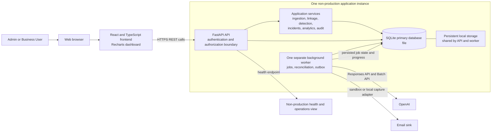

# ProductPulse Architecture Specification

**Version:** 1.4  
**Status:** Approved  
**Requirements source:** [PRD](PRD.md) v1.7  
**Decision sources:** [Decision Register](DECISION_REGISTER.md) v1.7 and [Tech Stack](TECH_STACK.md) v1.0  
**Data Model:** [DATA_MODEL.md](DATA_MODEL.md) v1.4 Approved — Design Baseline (conditional); v1.1 was the previous approved baseline  
**Approval date:** 21 November 2026

## 1. Purpose and approval boundary

This document describes the system boundaries and component relationships for the ProductPulse MVP. The PRD remains the source of product requirements. The Decision Register and Tech Stack supply approved technology choices and constraints. Any unresolved choice below remains unresolved; its appearance in this architecture is not approval.

This is a logical architecture specification. It is not an API contract, database schema, migration plan, deployment-provider selection, development ticket, or authorization to implement. `DATA_MODEL.md` owns exact persisted fields, types, constraints, and relationships; `API_SPEC.yaml` owns endpoint request/response/error/authentication contracts; `SECURITY.md` owns exact session configuration and account recovery; and `DETECTION_SPEC.md` owns exact source-coverage granularity, completeness criteria, and calibration parameters. These are separate authoritative specifications and must be consulted directly; their contracts must not be inferred from this architecture.

## 2. System overview, goals, assumptions, and boundaries

ProductPulse is a single-retailer product-quality monitoring application for a solo-developer capstone. An Admin uploads synthetic review and return CSV files. The backend validates and stores eligible records, runs classification through OpenAI, resolves product/supplier/batch links, computes defect trends deterministically, updates dashboard and incident evidence, and queues permitted notifications. Admins and Business Users use the dashboard and incident workflows. Processing continues in the background when no user is signed in.

### Architectural goals

- Preserve traceability from each source record through classification, cluster, incident, notification, and audit history.
- Keep ingestion, classification, detection, and email work durable and outside interactive dashboard requests.
- Enforce authorization and deterministic defect decisions in the backend.
- Keep the deployment practical for one developer and the approved 10,000-record synthetic MVP.
- Make freshness, failures, coverage gaps, model usage, and notification status visible enough for a capstone demo and runbook.

### Assumptions and constraints

- The MVP covers one fashion/apparel retailer and approximately 10,000 synthetic feedback records, with at least 35 days of UTC event-time coverage as specified in the PRD.
- The approved implementation choices are React + TypeScript with Recharts, one FastAPI backend, SQLite as the only primary relational database, one separately running worker, OpenAI Responses API for incremental classification, Batch API for historical backlogs, and an email sandbox or local capture adapter.
- The API and worker use the same SQLite database file on one active application instance. The file resides on persistent local storage that survives restarts/redeployments and is accessible to both processes. Do not assume a network filesystem or multiple application instances.
- The non-production deployment, health checks, protected secrets, logs/usage visibility, runbook, and demonstrated rollback are PRD requirements. A single Linux VM running Docker Compose is the preferred proposed OPS-01 topology; the hosting provider remains unselected and the topology remains Proposed.
- Secure email/password authentication with server-side sessions is approved under SEC-01. Exact session configuration and account recovery remain for `SECURITY.md`. ORM, migration tool, test tooling, frontend asset delivery, and several operational parameters are unresolved as listed in §19.

### MVP boundaries

- No Viewer role, SSO, multi-tenancy, watched-folder ingestion, production email delivery, supplier email, real customer/client data, or automatic external remedial action.
- No second database, separate broker, Redis, Kafka, Celery, microservices, multi-instance deployment, or network-filesystem database access is part of this architecture.
- OpenAI classifies feedback. It does not calculate KPIs, determine alert severity, authorize a user, or send email directly.
- The dashboard's 30-second refresh interval is a UI cadence, not a processing SLA. The PRD's performance targets remain measurement targets.

## 3. High-level component diagram

The browser interface, API, worker, provider adapters, and SQLite file are logical boundaries. The frontend asset-serving arrangement, concrete email sink, and hosting provider are not selected. The deployment must keep the API and worker on the same instance and give both access to the same persistent local database file.

## 4. Frontend architecture

The React + TypeScript frontend is the presentation layer. Recharts renders dashboard charts; no separate analytics or visualization service is introduced.

The UI is organized around the PRD's user workflows:

- **Login and session state:** show authenticated application areas according to the server's role result. The UI is not an authorization boundary.
- **Overview dashboard:** KPI cards, defect trends, category and product charts, supplier/batch comparisons, return reasons, warning list, filters, freshness, and manual refresh.
- **Product Intelligence and Feedback Explorer:** product trends and taxonomy breakdowns, searchable/paginated source records, classification states, and links to contributing records.
- **Incident views:** incident list, evidence/detail, lifecycle actions, notes, and notification history.
- **Admin Console:** CSV templates and upload preview/confirmation, job status and row errors, taxonomy/rule/recipient configuration, user management, processing health, and OpenAI usage/cost summaries.
- **Manual Alert Composer:** incident-scoped recipient selection from the approved directory, editable message, preview, and explicit confirmation.

Dashboard aggregates poll every 30 seconds and support manual refresh. The UI presents last import/classification/detection times and stale or incomplete states. A completed classification is not inferred from the poll cadence. Filters must apply consistently across cards, charts, tables, and drill-downs. PB-05 approves creating a shared metric glossary, not any metric definitions; the glossary remains a future specification artifact. Metric labels must state the counting unit and denominator, and the UI must not present unsupported return/failure rates.

Keyboard operation, readable loading/error/empty states, and color plus text for severity remain required. Frontend routing, component library, state-management package, and exact asset-delivery mechanism are unresolved; do not assume a particular library or hosting service.

## 5. Backend architecture and REST boundary

One Python FastAPI backend owns the REST boundary, server-side authorization, validation, and application services. The frontend never calls OpenAI or email providers directly.

Logical backend responsibilities are:

1. **Authentication and authorization:** use the approved secure email/password and server-side session approach; establish the authenticated user context and enforce the Admin/Business User permission matrix on every protected request.
2. **Request/API layer:** validate inputs, apply pagination and appropriate rate limits, return consistent errors, and expose the PRD's proposed REST surface.
3. **Ingestion service:** validate uploads, produce preview results, enforce confirmation, persist accepted source records and job state, and report conflicts/rejections.
4. **Classification orchestration:** create durable work for historical or incremental classification and validate completed outputs.
5. **Linkage and configuration services:** resolve explicit product/supplier/batch identifiers and provide Admin-controlled taxonomy, rules, and approved recipient settings.
6. **Detection and analytics services:** compute deterministic cluster results and dashboard aggregates from persisted, eligible records.
7. **Incident and notification services:** validate incident transitions, audit actions, create outbox requests, and return current notification state.
8. **Persistence access:** read/write the shared SQLite file with short transactions and the connection settings in §6.

The PRD's `GET /dashboard/summary`, `GET /dashboard/trends`, product, feedback, incident, notification, Admin ingestion/settings, and `/health` routes are the starting surface. `API_SPEC.yaml` v1.4.0 (Approved — Design Baseline, conditional; v1.1.0 was the previous approved version) defines upload preview/confirmation, job/status/retry, notification recovery, downloadable rejection-report, and Admin reconciliation contracts, including immutable preview identity and verified file-hash binding. This document does not define endpoint paths or request/response schemas. The frontend must not be trusted to enforce role scope or confirmation rules.

Provider credentials remain on the backend in protected server-side configuration. Health and Admin status views expose processing state without returning secrets or raw feedback in telemetry.

## 6. Domain and persistence architecture

SQLite is the only primary relational database. One persistent database file holds the PRD's logical entities, including users, products, suppliers, batches, ingestion jobs, feedback, classifications, source coverage, conflicts, clusters, incidents, incident events, notifications/outbox state, and audit logs. This section describes logical responsibilities, not a physical schema or migration.

`DATA_MODEL.md` v1.4 is the Approved — Design Baseline, subject to documented conditions; it includes detection, alert-recovery, and DAI-08 mapping fields. It defines the exact persisted fields, types, nullability, constraints, foreign keys, and indexes, including the durable classification-to-job relationship and Batch input-file recovery identifier. `API_SPEC.yaml` v1.4.0 (Approved — Design Baseline, conditional; v1.1.0 was the previous approved version) defines the endpoint contracts that expose or update these records.

### Integrity and traceability

- Enforce foreign-key relationships and source-to-classification-to-cluster-to-incident traceability.
- Enforce global uniqueness for `(source_type, source_record_id)` and for stable notification event identities. Use stable identities/idempotency keys for ingestion retries, job completion, incident updates, and notification requests.
- Preserve original source text and event time in the normal workflow; record ingestion/processing timestamps separately. Conflicting payloads do not overwrite a prior source record.
- Store audit actor, action/result, timestamp, and before/after state where required for incident actions and Admin configuration changes.
- Use indexes only as justified by the PRD's query needs and measured performance; index selection belongs in the data-model specification.

### SQLite connection and transaction rules

- Enable `PRAGMA foreign_keys=ON` on **every** database connection.
- Use WAL mode where supported. Configure an explicit busy timeout for database connections; its duration is unresolved.
- SQLite serializes writes: WAL can support reader/writer coexistence where supported, but it does not allow multiple simultaneous writers. API requests and the worker can contend for the one writer slot.
- Keep all write transactions short. A transaction may validate/claim/persist internal database state, then must commit before network I/O. Never hold a SQLite transaction open while calling OpenAI or the email provider. After the external call, open a new short transaction to persist the outcome.
- Use relational uniqueness, foreign keys, and conditional/idempotent updates rather than database-specific locking features. Do not assume advisory locks, `SKIP LOCKED`, JSONB, or another database.
- Do not increase worker count, add a second database, or move the file to shared network storage as a contention workaround without an explicitly approved architecture change.

### Concurrent-write and scaling limit

The API and the worker share a single SQLite writer. Short transactions and a busy timeout reduce avoidable contention; they do not remove the single-writer limit. Measure the unchanged PRD p95 and processing-latency targets with API and worker writes active. Lock-contention policy and numeric timeout are unresolved under ARC-03/ARC-04. Horizontal scaling and multi-instance access are outside this MVP boundary.

## 7. Admin-only CSV ingestion

The Admin Console and ingestion service implement the PRD's manual upload flow:

1. An Admin submits a review CSV, return CSV, or supported reference CSV for a validation preview.
2. The service writes the exact uploaded bytes to a temporary file in the protected persistent local artifact directory, verifies their hash, and atomically publishes them under a server-generated opaque artifact ID. It commits the SQLite metadata reference only after publication; the database stores metadata and the ID, never the file bytes as a BLOB. The preview identity is bound to that immutable artifact ID, verified hash, and validation results. The service applies the PRD limits (20 MB and 50,000 rows), validates encoding, format, required columns, identifiers, timestamps, feedback text, and mapping references, then returns accepted/rejected counts, duplicates, missing keys, conflicts, and row-level reasons.
3. The preview makes a downloadable row-level rejection report available. Store generated report bytes in the same protected directory and persist their opaque artifact ID and metadata linked to the preview. Deliver files only through authorized backend routes; do not expose filesystem paths or serve the directory publicly. Rejected rows and reasons remain available from the preview/job record for Admin review; valid rows may still be accepted under the PRD's partial-acceptance rule.
4. The Admin explicitly confirms by referencing the immutable preview identity and its verified file hash. The server securely resolves the opaque artifact ID beneath the configured storage root and verifies that confirmation refers to the exact staged bytes and hash that were previewed; it rejects confirmation if they do not match. Only then do confirmed valid rows enter normal persisted ingestion. Artifact retention/expiry remains for the API and operations specifications.
5. At confirmation, the Admin selects `HISTORICAL_BATCH` or `INCREMENTAL_RESPONSES` for a review/return import; reference-data imports have no processing mode. Confirmation creates durable import-job state containing the immutable mode. The worker processes the import and reports queued/running/completed/partial/failed status and counts for the Admin. Preserve the upload file hash, uploading actor, relevant timestamps, job ID, accepted/rejected counts, linkage status, and reconciliation audit trail.
6. After newly accepted feedback is persisted, automatically queue classification through the mode's corresponding OpenAI API. The worker uses Batch API for `HISTORICAL_BATCH` and Responses API for `INCREMENTAL_RESPONSES`; no separate user-triggered classification action is required. The Admin can inspect failures and retry eligible work, preserving the original mode and source identities.

`DATA_MODEL.md` v1.4 is the Approved — Design Baseline, subject to its documented conditions. It owns exact persistence field names and constraints for upload/report artifact IDs and metadata, preview identity and mapping, verified hash, job metadata, row rejection details, linkage status, and classification/Batch recovery traceability. DAI-08 approves the Admin mapping semantics, which are included in this baseline. OPS-06 approves protected local filesystem artifacts, atomic publication before the SQLite reference, orphan reconciliation, and a joint database/artifact recovery set. `API_SPEC.yaml` v1.4.0 (Approved — Design Baseline, conditional; v1.1.0 was the previous approved version) owns the endpoint contracts for preview creation, hash-bound confirmation, downloadable row-level rejection reports, job/status/retry operations, and Admin reconciliation. Artifact expiry/retention remains a downstream operations detail.

Business Users cannot upload, preview, confirm, or retry ingestion. A direct API attempt returns `403` and creates no stored file or job. Classification dispatch follows the immutable mode selected by an Admin; there is no Business User ingestion or retry control. Identical `(source_type, source_record_id)` plus identical payload is a no-op, including within an upload. A differing payload is an Admin-visible conflict; it never overwrites source text. Partial row acceptance is supported (DAI-01/DAI-02). Supplier/batch references are taken from valid rows or explicit mappings; conflicting mappings are surfaced for review rather than guessed.

## 8. Background worker, durable jobs, and recovery

One separately running worker polls the same SQLite file used by the API. It handles durable ingestion/classification work, Batch API submission/result collection, detection recomputation/reconciliation, and notification outbox delivery. It is not an in-process background task tied to a user's request and does not require a broker.

The approved behavior is durable state, bounded retries for transient provider errors, terminal failure visibility, Admin retry where permitted, idempotency, and scheduled reconciliation. Under DAI-07, confirmed feedback imports persist an explicit mode: `HISTORICAL_BATCH` automatically dispatches newly persisted eligible feedback through the OpenAI Batch API; `INCREMENTAL_RESPONSES` uses the Responses API. Reference imports have no mode. Retries preserve the confirmed mode, and no separate classification trigger is exposed to Business Users. Numeric retry/backoff limits and reconciliation cadence remain open under OPS-02.

### Proposed SQLite-compatible processing pattern

The following lease-token pattern is a recommendation in the Tech Stack, not a separately approved implementation contract:

1. Persist the durable job/outbox identity in a short transaction.
2. The single worker claims an eligible item and records a lease token/expiry in a short write transaction, then commits.
3. Perform OpenAI/email network I/O with no database transaction held.
4. Persist the result in a new short transaction, conditioned on the current lease token and stable work identity so a stale worker cannot overwrite newer work.
5. Persist retry attempt/next eligible time for transient failures; retain terminal failures for Admin visibility/recovery. On restart, make expired leases eligible for recovery and use reconciliation to find stale/incomplete work.

The notification outbox follows the same short claim/call/record pattern. Whenever an incident state change requires a notification, persist the incident state change and associated outbox event in the same atomic SQLite transaction. If either local database operation fails, roll back the whole transaction so neither may commit without the other. Commit before any email-provider call, and persist the provider outcome in a separate short transaction after the call. All OpenAI and email-provider calls always occur outside database transactions. Provider acceptance is not delivery; exactly-once external email delivery is not promised. `ALERT_SPEC.md` defines expired-notification-lease reconciliation and no automatic resend of OUTCOME_UNKNOWN absent provider verification or an approved policy; external idempotency remains open.

Background-job lease duration/renewal, atomic job-claim transaction details, `SQLITE_BUSY` retry handling, and numeric retry parameters remain unresolved under ARC-04/OPS-02. Notification lease expiry and uncertain-outcome handling are defined in `ALERT_SPEC.md`; no external provider call is promised exactly once.

## 9. OpenAI classification architecture

All OpenAI calls originate from the backend worker through an adapter boundary:

- **Incremental path:** use the Responses API for newly ingested eligible feedback.
- **Historical path:** use the Batch API for the historical backlog, with persisted submission/job status and result reconciliation.
- **Common contract:** both paths use the same selected model and versioned strict Structured Outputs contract. The model identifier is not selected; DAI-05 approves the evaluation/selection process only.
- **Batch correlation and recovery:** persist each classification attempt and its non-null source/job relationship before submission; set Batch `custom_id` to the immutable `classification_id`; persist the input-file ID before creating the Batch and recover ambiguous submissions by stable job metadata plus input-file ID. Reconcile by `custom_id`, never output order, and apply local outcomes idempotently.
- **Validation:** check schema version, allowed taxonomy values, source-record identity correspondence, evidence grounding, and optional secondary labels before marking classification complete. Invalid/uncertain outcomes remain visible and do not become `no_defect`.
- **Processing states:** semantic uncertainty maps to needs-review; transient failures are retryable only while eligible; refusals, invalid output, identity/evidence validation failures, and exhausted retries are terminal failures. Preserve queued/in-progress, completed, retryable-failed, terminal-failed, and needs-review outcomes. Failed or uncertain records remain outside confirmed complaint counts and are visible through classification coverage.
- **Safety:** feedback is untrusted data; embedded instructions are classified, not followed. The model's severity hint is advisory and cannot set final warning severity.
- **Traceability/measurement:** persist model, prompt/schema version, token usage, latency, estimated cost, job state, and classification state without exposing API credentials. Track cost per 1,000 records including retries and Batch versus incremental work.

Prompt shape, final schema fields, model ID, cost/rate limits, and exact retry settings are not chosen by this document. Taxonomy changes remain versioned and audited; freeze the initial taxonomy for held-out evaluation. Every classification retains its taxonomy version. A versioned specific issue code maps explicitly to a stable logical defect identifier; semantically equivalent meanings may share that identifier across versions, while a changed meaning receives a new identifier and is never automatically merged. In the MVP, a new taxonomy version applies to new/retried classifications unless a separate historical reclassification job is defined and approved, as specified by DAI-04.

## 10. Product, supplier, batch, and source linkage

The linkage service uses identifiers in valid feedback rows first and then explicit imported mappings, following DAI-01. It preserves source identity and lineage and never fabricates supplier or batch identifiers.

Valid feedback with unresolved supplier/batch references is stored with `LINKAGE_PENDING` and is excluded from supplier/batch-specific incidents. When `product_id` is valid, include these records in distinctly labelled product-level analytics. Product defect totals count distinct fully linked feedback records with a successfully validated defect classification; pending-link records are excluded from those totals and exposed in separately labelled pending-feedback and pending-defect counts. Return-record counts and known returned units remain separate, with pending-link returns identified separately. Do not fabricate supplier or batch identifiers, and do not generate product-only incidents or automatic notifications from unresolved-link records. Admin mapping corrections are audited and trigger recomputation of affected detection results. Conflicting mapping inputs are shown for Admin review.

This behavior is approved under PB-06. Batch-specific incident keys require resolved product, supplier, batch, and stable logical defect identifier. Explicitly compatible taxonomy codes therefore share a cluster; a changed meaning uses a new identifier and remains separate. After reconciliation supplies valid linkage, the record may participate in the affected batch-specific detection results under the approved rules.

## 11. Deterministic defect detection and recomputation

The detection service runs in the worker and owns all counts, baselines, rule decisions, incident triggers, and alert eligibility. It consumes only validated completed classifications and eligible source records; one distinct feedback identity counts at most once per issue cluster.

### Windows, coverage, and evidence

- Use UTC event time. At evaluation instant `T`, the observed window is `[T−7 days, T)` and the baseline window is `[T−35 days, T−7 days)`.
- A usable baseline requires declared complete coverage for the full preceding 28 days. Normalize the baseline as `baseline_28d_count / 4`; compute a ratio only for a nonzero usable baseline.
- For a complete zero baseline, use count-only thresholds and display `No prior observed complaints`; never display an infinite multiplier.
- For insufficient coverage, display `Insufficient historical baseline` in analytics and operational monitoring, retain the coverage state and trend evidence, and do not create an automatic defect warning or incident or generate an automatic warning email. Do not assign a validated severity from an unsupported ratio. When coverage intervals or late-arriving records establish sufficient coverage, recompute and reconsider the affected detection windows using the existing versioned rules and their current approval status.
- Record evaluated time, source IDs, counts, coverage state, linkage state, normalized baseline, and rule version as detection evidence; attach it as incident evidence only when an incident is created.
- Recompute affected aggregates after new classifications, mapping corrections, and late-arriving records. Scheduled reconciliation detects missed work.

The DAI-06 methodology is Approved: use UTC event timestamps, preserve ingestion and processing timestamps, track explicit source-coverage intervals, never interpret missing coverage as zero complaints, recompute affected windows for late-arriving records, and do not send automatic warnings when required baseline coverage is insufficient. Exact coverage granularity, completeness criteria, and calibration parameters remain **Pending Calibration** for `DETECTION_SPEC.md`. The provisional numeric severity thresholds in PRD §9.2 are calibration hypotheses, not approved final values under PB-01:

| Severity | Usable nonzero baseline (provisional) | Complete zero baseline (provisional) | Incident/email behavior from PRD |
|---|---|---|---|
| Informational / trend-only | No qualifying medium threshold | Fewer than 5 complaints | Trend only; no incident or email |
| Medium | At least 5 complaints and at least 2× baseline | At least 5 complaints | Create/update incident; no automatic email |
| High | At least 10 complaints and at least 3× baseline | At least 10 complaints | Create/update incident; sandbox email |
| Critical | At least 20 complaints and at least 5× baseline | At least 20 complaints | Create/update priority incident; priority sandbox email |

Choose the highest qualifying severity. Model output cannot trigger severity or Critical. Do not infer a return/failure rate without valid sales/transaction denominators. PB-01 calibration must freeze/version the rule configuration before held-out evaluation.

## 12. Dashboard analytics, filters, and source drill-down

Dashboard reads use FastAPI aggregate/query services over the same SQLite data. The dashboard does not trigger classification or perform the detection rules in the browser.

- **Overview:** analysed records, classification coverage, unique defect-bearing records, return-record count, active/critical warnings, products at risk, and freshness.
- **Charts:** complaints by day/week, categories, affected products, supplier/batch comparisons, returns by reason, and severity distribution.
- **Filters:** date, product, category, supplier, batch, defect, severity, and warning status; apply consistently to cards, charts, and detail queries.
- **Drill-down:** navigate from a chart/warning to product or incident detail and contributing original review/return records, source IDs, timestamps, classification/version, and lineage.
- **Freshness and coverage:** show last successful import, classification, detection recomputation, pending/failed jobs, stale-data warnings, and explicit source-coverage status, including `Insufficient historical baseline`. Incomplete classification/coverage must not be presented as a low-risk result. Reconsider affected detection windows after coverage updates or late-arriving records establish sufficient coverage.
- **Refresh:** poll aggregate views every 30 seconds and support manual refresh. Show the event window, timezone, and data freshness.

Complaint records, return records, and returned units remain separate measures. Any feedback proportion requires a stated eligible-feedback denominator and must not be called a product failure rate. Dashboard p95 <= 3 seconds on 10,000 records and display within 60 seconds after successful classification remain targets to measure, not guarantees or provider queue SLAs.

## 13. Incident lifecycle and audit history

The incident service stores detection evidence and validates every status change server-side (PB-02). Its core states and transition path are `NEW → ACKNOWLEDGED → INVESTIGATING → RESOLVED`, with `RESOLVED → REOPENED → INVESTIGATING` for qualifying recurrence. Basic investigation notes are P0. Audit each action with actor, timestamp, note/action, and before/after state. Reject stale/conflicting transitions with an auditable result.

Maintain at most one open incident per cluster. New qualifying evidence updates its counts and source links; decreasing counts do not automatically resolve it. Derive severity from the versioned deterministic rule result, not from the model hint. Preserve all previous episodes and investigation history.

PB-03 and PRD §9.3/AC22 agree: qualifying recurrence within 30 days of the stored resolution timestamp reopens the same incident; later recurrence creates a linked episode. PRD §19.1 records the recurrence rule as approved and does not list it among items awaiting formal sign-off.

## 14. Automatic and manual email notifications

Email delivery is backend-only and uses the approved adapter boundary with a sandbox or local capture sink (ARC-05). The concrete sink/provider remains open. The MVP does not send to suppliers or real external recipients.

- **Automatic:** High/Critical rule events create stable, deduplicated outbox events. Apply the fixed 86,400-second cooldown per incident and severity across all routes; MVP notification-rule requests cannot override it. Severity escalation bypasses cooldown. Medium does not automatically email. Provider/sandbox unavailability does not suppress qualifying incident/outbox persistence; unavailable approved routing/fallback creates a visible no-route state and no send.
- **Automatic content:** include incident ID, product, supplier, batch, defect type, severity, observed distinct count, baseline, first-detected time, evidence summary, and secure incident link; do not include personal customer details or unverified numeric claims.
- **Manual:** Admin and Business User may start an incident-scoped composition. The API rechecks role and recipient authorization, serves preview, and requires explicit confirmation plus an idempotency key before queuing the send. Leaving the preview without confirmation creates no send. Exact recipients/content/actor/status are audited. Sandbox outage leaves a durable queued/failed state; report send success only after the provider accepts the request.
- **Outbox:** Persist queued/sending/accepted/failed state and provider message identifiers as available. The worker performs provider calls outside SQLite transactions. The UI must distinguish queued, provider-accepted, and delivered/bounced status; acceptance is not proof of delivery. Expired SENDING leases with queued attempts return to QUEUED; abandoned IN_PROGRESS attempts become OUTCOME_UNKNOWN and are not automatically resent absent verification or an approved policy.
- **Safety:** Use only the Admin-managed approved internal/sandbox directory; no arbitrary recipient entry and no supplier email. Keep personal customer details out of notification content.

The broad recipient safety boundary and trigger/cooldown approach are approved under SEC-03/PB-04. The final directory, fallback inbox, exact routing configuration, provider callbacks, and sink implementation remain to be specified. The PRD §19.1 sign-off list calls out recipient directory/fallback/event details; this architecture does not choose them. For any incident state transition that requires a notification, ARC-07 requires atomic persistence of the incident change and outbox event. The provider call occurs after commit, and its outcome is recorded separately; `ALERT_SPEC.md` defines conservative uncertain-outcome recovery while provider verification and external idempotency remain open.

## 15. Authentication, RBAC, and security boundaries

The API is the enforcement boundary. Admin and Business User access is single-retailer and server-authorized on every route. Business Users may view analytics and feedback, investigate incidents, add notes, resolve/reopen as permitted by the PRD, and send confirmed manual alerts to approved recipients. They cannot upload, preview, confirm, retry ingestion, or configure system settings. Admins manage ingestion, configuration, users, and processing operations. Viewer and SSO are out of MVP.

SEC-01's authentication approach is **Approved**: use secure email/password authentication with server-side sessions for Admin and Business User roles; secure password hashes; session cookies with the `Secure` and `HttpOnly` attributes; appropriate CSRF protection; session expiry and logout invalidation; and a protected setup command to provision the first Admin. Public self-registration and SSO are out of scope. Admins create and deactivate users. Exact session configuration and account recovery details belong in `SECURITY.md`.

Security boundaries:

- Keep OpenAI and mail-provider secrets in protected server-side environment/secrets management. Never expose them to the browser, commit them, include them in prompts/logs, or return them in API responses.
- OpenAI credential management is restricted to the backend deployment administrator; it is not a Business User capability.
- Use TLS in deployment, parameterized database access, and least-privilege filesystem permissions for the SQLite file and persistent storage.
- Validate files and external input; enforce upload limits; redact raw feedback from logs/traces; escape formula-leading values in exports if an export is added.
- Treat feedback text as untrusted. Test prompt injection and direct unauthorized Admin API calls.
- Use synthetic or permitted public non-sensitive data only; no customer/client data, PII, or PHI.
- Do not send real external email or take external remedial actions without separate explicit approval.

## 16. Logging, monitoring, freshness, and error handling

The operational view is the Admin Console, dashboard freshness indicators, health endpoint, and a concise runbook—not a separate operations product. Monitoring requirements come from OPS-05 and the PRD.

Expose or report:

- Service health and observable worker/job status.
- Import/job counts and age, accepted/rejected rows, classification states, queue/pending counts, failed/terminal work, and reconciliation freshness.
- Last successful import, classification, and detection timestamps; dashboard data freshness and coverage maturity; explicit insufficient-baseline status and affected windows awaiting reevaluation.
- Notification outbox state, failures, provider acceptance status, and stuck sends.
- OpenAI model/version, token usage, latency, retries, and estimated cost, including cost per 1,000 records.
- Evaluation metrics, local automated check outcomes, and documented pre-merge checklist evidence.

Operational logs should identify the job, incident, and action needed for investigation while excluding raw feedback and secrets. Validation failures are reported with row-level reasons; transient provider errors use bounded retries; terminal failures remain visible for Admin recovery; permanent input/schema errors are not retried as provider failures. Numeric retry limits and the logging/monitoring product are not selected.

## 17. Non-production deployment, persistence, backup, and rollback

The preferred proposed OPS-01 topology is one Linux VM running Docker Compose, with one FastAPI API process and one separate worker process. This topology remains **Proposed**, and no cloud hosting provider is selected or approved. The SQLite file and protected artifact directory must be on persistent local storage accessible to the API and worker and retained across process restart and application redeploy. Keep the artifact directory outside public/static delivery and out of Git; do not accept client paths when resolving IDs. Do not deploy multiple active application instances against the SQLite file or place either store on a network filesystem. The frontend's static delivery mechanism also remains unselected.

Before deployment approval, verify that the selected provider supports the proposed topology and persistent local storage, protected secrets, TLS, health checks, logs/usage visibility, backups, and rollback evidence. `/health` reports service health; Admin operational views expose worker/job progress. Provider selection and suitability are deployment-specification decisions, not changes to the logical component boundaries.

### Safe SQLite operations

- **Backup:** OPS-06 requires the SQLite database and all referenced artifact files to be captured as one consistent recovery set. Quiesce database writes and artifact publication/deletion while taking the set; use a SQLite-consistent backup mechanism (the SQLite backup API is one acceptable approach), or stop API/worker writes and checkpoint WAL before a coordinated snapshot. Never copy only the main database file during active WAL writes. Exact mechanism, cadence, and retention remain open under OPS-03.
- **Restore:** stop both processes, restore the database and artifact directory from the same recovery set using the documented SQLite-aware procedure, avoid mixing database/sidecar/artifact state from different snapshots, verify database integrity and foreign-key relationships, and verify every referenced artifact exists and matches its stored hash before restarting API and worker.
- **Reset/reseed:** restrict to the non-production synthetic dataset. Preserve a consistent snapshot first if audit/evaluation evidence must be retained. Stop both processes before replacing/resetting the database file and verify integrity before restart.
- **Rollback:** retain a compatible recovery snapshot before schema-changing releases. A previous application version does not automatically reverse a schema change. If schema compatibility requires restoring a prior snapshot, stop both processes and follow the restore procedure; disclose that later demo records may be lost. Verify health after both processes restart.

OPS-03 approves the documented recovery/reset expectation but leaves backup cadence, retention, and exact backup mechanism open. The migration tool is also not approved; this architecture does not prescribe migration commands or claim production recovery guarantees.

## 18. Architectural trade-offs and alternatives

| Choice | Benefit for this MVP | Cost or limitation |
|---|---|---|
| One FastAPI backend | Keeps authorization, validation, and domain services in one place for a solo developer. | API boundaries and contracts must be specified carefully as one service grows. |
| SQLite in one persistent file | Avoids operating a separate database service while preserving relational constraints and traceability for the synthetic dataset. | Single-writer contention; local persistent storage and one active instance are mandatory; no horizontal scaling. |
| One separate SQLite-backed worker | Keeps slow provider calls out of interactive requests and avoids a broker for the initial workload. | API and worker compete for one writer; leases/recovery and idempotency need careful specification. |
| Deterministic detection after AI classification | Makes counts, severity, and evidence reproducible; model output remains advisory. | Coverage, late arrival, thresholds, and rule versioning still require calibration and clear presentation. |
| Sandbox/local email adapter | Exercises outbox, retry, and audit flows without real delivery. | Sink/provider and callbacks remain open; provider acceptance cannot guarantee delivery. |
| 30-second aggregate polling | Simple, explicit UI freshness behavior. | It is not streaming and can show stale results while background work is delayed. |

Alternatives considered in the register include a separate durable broker/queue and synchronous request processing. Synchronous provider work was not selected because it would block interactive requests. A separate broker, another database, or additional application instances are outside the approved MVP architecture and require explicit approval if reconsidered.

## 19. Unresolved decisions and dependencies

The table records remaining open choices and dependencies, plus cross-document status confirmations. Any Approved status reflects the Decision Register; this architecture does not grant approval.

| Decision / reference | Current status | Architecture consequence |
|---|---|---|
| SEC-01 authentication/session and initial Admin provisioning | Approved approach | Use secure email/password, server-side sessions, protected first-Admin setup, and Admin-managed users; exact session configuration and account recovery belong in `SECURITY.md`. |
| ARC-02 REST request/response details and preview/confirm route contract | Approved approach; contract open | API table is only the starting surface; do not generate client/server contracts from this document. |
| ARC-03 ORM and migration tooling | Approved: SQLAlchemy 2.x and Alembic 1.x for SQLite and versioned migrations | Exact compatible package releases are resolved and locked during project setup; SQLite remains the only primary database. |
| ARC-03/ARC-04 SQLite connection and concurrency parameters | Required constraints documented; exact parameters open | Busy-timeout duration, `SQLITE_BUSY` handling, atomic claim approach, and transaction details need a downstream spec. |
| ARC-04 job/outbox leases and recovery | One worker and durable SQLite state Approved; notification uncertainty rule defined in ALERT_SPEC | Background-job lease duration/renewal, atomic claim details, stale worker protection, and `SQLITE_BUSY` recovery remain open; notification leases follow ALERT_SPEC's QUEUED/OUTCOME_UNKNOWN reconciliation. |
| OPS-02 retry and reconciliation parameters | Bounded retries/reconciliation Approved; numeric limits/cadence open | Set provider-aware limits and schedule without weakening visibility or idempotency. |
| OPS-03 backup/recovery parameters | Recovery/reset expectation Approved; cadence, retention, and mechanism open | Complete runbook details before deployment; no production guarantees. |
| OPS-06 local artifact storage | Approved | Keep uploaded CSV and rejection-report files in protected persistent local storage shared by API and worker; store opaque IDs/metadata in SQLite, publish atomically, reconcile orphan files, and back up/restore the database and referenced files as one set. Retention/expiry remains open under OPS-03. |
| OPS-01 provider/topology | Proposed | Linux VM with Docker Compose is the preferred proposed topology; select and verify a provider that supports the shared persistent local SQLite file, protected artifact directory, and required operations before deployment. |
| DAI-05 OpenAI model identifier | Selection method Approved; model ID open | Evaluate support for both APIs and strict output contract before choosing a model. |
| ARC-05 email sink/provider and recipient routing details | Adapter/sandbox boundary Approved; specific sink open | Select a local or hosted capture sink and finalize the approved directory/fallback before notification integration. |
| ARC-06 local verification | Approved | Use repeatable local PowerShell scripts, approved test runners, and a documented pre-merge checklist with exact-revision evidence; no hosted CI merge-gate service or workflow is used. |
| PB-01 detection thresholds/minimum counts | Pending Calibration | Keep PRD values provisional; calibrate on development scenarios and freeze before held-out evaluation. |
| PB-06 unresolved-link behavior | Approved | Include valid-product records in labelled product-level analytics as `LINKAGE_PENDING`; no product-only incidents or automatic notifications; recompute after Admin reconciliation. |
| DAI-06 coverage methodology and parameters | Methodology Approved; parameters Pending Calibration | Use explicit UTC source-coverage intervals, preserve timestamps, treat missing coverage as unknown, recompute late arrivals, create no automatic warning or incident and send no automatic warning email while required baseline coverage is insufficient, expose that state in analytics/monitoring, and reconsider affected windows when coverage becomes sufficient. Specify exact parameters in `DETECTION_SPEC.md`. |
| PB-04 notification edge cases | Approved core behavior; nuances open | Specify severity decreases, re-crossings, and recurrence interactions without changing the approved trigger/cooldown boundary. |
| PB-03 recurrence boundary | Approved; PRD reconciled in v1.3 and retained in v1.7 | The 30-day rule remains as stated in PRD §9.3 and AC22; no recurrence sign-off remains. |
| EV-01 held-out dataset size | Method approved; size parameters Pending Calibration | Finalize counts/representation before dataset lock. |
| EV-02 classification gates | Pending Calibration | Derive class-specific gates before held-out evaluation. |
| EV-03 planted-episode recall gate | Pending Calibration | Validate whether the provisional >=90% target is supported by scenario counts. |
| EV-04 lead-time comparator | Evaluation methodology Approved; comparator method is selected during development and frozen before held-out evaluation | Apply the chosen documented comparator to the identical event-time stream; do not add a user-facing sentiment feature for this evaluation alone. |
| EV-05 cost reporting | Cost tracking Approved; no spend limit/gate approved | Track model/retry/path cost and report cost per 1,000 records; add no budget gate without explicit confirmation. |
| Test and frontend tooling | Approved in TECH_STACK v1.0: pytest/FastAPI TestClient, Vitest/React Testing Library, React Router, MUI, TanStack Query, and React state/context | Use the selected packages and repeatable local PowerShell check runner; retain ticket-level test evidence. No Playwright or browser E2E framework is selected. |
| ARC-07 incident state/outbox atomicity | Approved; provider verification details open | Incident changes requiring notification and their outbox events commit atomically; `ALERT_SPEC.md` defines expired-lease reconciliation and prohibits automatic resend of OUTCOME_UNKNOWN absent verification or an approved policy. |
| PB-05 metric definitions | Glossary creation Approved; definitions not approved | Create the shared glossary before dashboard specification; do not treat metric definitions as approved by PB-05. |
| Ingestion persistence and endpoint contracts | Data Model v1.4 and API v1.4.0 are Approved — Design Baselines, subject to documented conditions; v1.1/v1.1.0 were previous approved baselines | Exact fields are defined in `DATA_MODEL.md`; preview/confirm, rejection-report, job, and reconciliation contracts are defined in `API_SPEC.yaml`. |

### Cross-document sign-off note

PB-03 and PRD v1.7 §9.3/AC22 agree on the approved 30-day recurrence rule; PRD §19.1 no longer lists recurrence as awaiting sign-off. SEC-01 and PB-06 approaches and DAI-04's stable logical defect identity across semantically compatible taxonomy versions are Approved. OPS-06's protected local filesystem artifact storage and joint recovery-set requirements are Approved; expiry/retention and exact backup operations remain open under OPS-03. DAI-06 methodology is Approved, but its exact parameters remain Pending Calibration for `DETECTION_SPEC.md`. OPS-01 remains Proposed and no provider is selected. ARC-07 is approved for local atomicity and conservative uncertain-outcome recovery; provider verification and external idempotency remain open under `ALERT_SPEC.md`. The final recipient directory/routing and evaluation parameters retain their existing sign-off/calibration statuses.

## 20. P0 requirement-to-component mapping

### P0 feature mapping

| PRD feature | Architecture components | Coverage / open decision |
|---|---|---|
| F01 Login, session handling, RBAC | Frontend login; FastAPI auth/authorization boundary | SEC-01 approach Approved: secure email/password, server-side sessions, secure password hashes, `Secure`/`HttpOnly` cookies, CSRF protection, expiry/invalidation, protected first-Admin setup, and Admin-managed users; exact settings/recovery in `SECURITY.md`. |
| F02 Admin-only CSV upload and validation | Admin Console; ingestion REST/service; protected local artifact directory | 20 MB/50,000-row limits; opaque upload artifact ID and metadata in SQLite; file published atomically before metadata reference; immutable preview identity bound to exact file/hash; partial acceptance. |
| F03 Import status, error report, retry | SQLite job state; worker; Admin Console; protected local artifact directory | Downloadable rejection-report bytes stored as a protected file with SQLite ID/metadata linked to preview; preserve upload hash, actor, timestamps, job ID, accepted/rejected counts, linkage status, and reconciliation audit; bounded retries approved, numeric parameters open (OPS-02). |
| F04 Historical classification with Batch API | Admin-selected `HISTORICAL_BATCH` mode at confirmation; worker automatically queues newly persisted eligible feedback through the Batch API | Mode is immutable for the import and preserved on Admin retry; model ID open (DAI-05). |
| F05 Near-real-time classification | Admin-selected `INCREMENTAL_RESPONSES` mode at confirmation; worker automatically queues newly persisted eligible feedback through the Responses API | Mode is immutable for the import and preserved on Admin retry; provider queue time excluded from PRD display target. |
| F06 Strict-schema classification/taxonomy | Classification orchestration and validator; versioned taxonomy | Uncertain/invalid items stay visible and do not become `no_defect`. |
| F07 Product/supplier/batch/source linkage | Linkage service; SQLite relational entities; Feedback Explorer | PB-06 Approved: valid product-level analytics may include `LINKAGE_PENDING`; no product-only incidents or automatic notifications; reconcile and recompute. |
| F08 Rule-based emerging-defect detection | Deterministic detection service in worker | DAI-06 methodology Approved; exact coverage parameters and PB-01 thresholds/minimums remain pending for downstream calibration. |
| F09 Auto-refresh dashboard and filters | React dashboard; FastAPI aggregate queries | 30-second UI polling; no processing SLA implied. |
| F10 Product/defect detail and source drill-down | Product/incident views; feedback query service | Preserve IDs, calculations, classifications, and lineage. |
| F11 Automatic warnings and email | Detection; incident service; SQLite outbox; worker/email adapter | High/Critical rules, cooldown, escalation; incident state plus required outbox event commit atomically (ARC-07); sandbox only. |
| F12 Manual alert preview and confirmation | Incident UI; FastAPI recipient authorization; outbox | Explicit confirmation/idempotency; no arbitrary or supplier recipients. |
| F13 Warning lifecycle and audit | Incident service; incident events/audit; SQLite | Server validates transitions; record actor, timestamp, notes and state changes. |
| F14 Alert deduplication/cooldown | Stable event identity; uniqueness/idempotency; notification rules/outbox | Fixed 86,400-second same-severity cooldown, no MVP override, and escalation bypass; provider exactly-once not promised. |
| F15 Processing health/freshness | Admin Console/dashboard status; health endpoint; persisted job state | Expose job age/failures, last import/classification/detection and stale warnings. |
| F16 Evaluation and local automated verification | Evaluation pipeline and local PowerShell check runner; documented pre-merge checklist | ARC-06 local process approved; EV-01 size, EV-02 gates, and EV-03 recall remain pending. |
| F17 Investigation notes | Incident UI/API; incident events/audit | Notes are P0 and chronologically auditable. |

### Acceptance-criterion mapping

| PRD criterion | Architecture coverage |
|---|---|
| AC01 | Server-side RBAC rejects Business User ingestion with 403 and no stored file/job. |
| AC02 | Admin confirmation references the immutable preview identity and verified hash, selects the required feedback processing mode, creates durable job state, persists accepted records once, and automatically dispatches classification through the selected API. |
| AC03 | Preview/confirm flow supports partial acceptance and makes downloadable row-level rejection reasons available. |
| AC04 | Stable source/job identities make Admin retries idempotent, preserve the confirmed processing mode, and prevent duplicate source records/incidents. |
| AC05 | Classification validator checks strict output and source-record correspondence. |
| AC06 | Backend treats feedback as untrusted input and tests prompt-injection resistance. |
| AC07 | `HISTORICAL_BATCH` imports automatically queue Batch API work after accepted feedback is persisted; results are tracked, validated, and included in aggregates by the worker. |
| AC08 | `INCREMENTAL_RESPONSES` imports automatically queue Responses API work after accepted feedback is persisted; results update classification state and recompute affected dashboard aggregates. |
| AC09 | Detection worker creates a warning with reproducible counts/baseline/rule evidence. |
| AC10 | Existing incident is updated and stable outbox identity plus cooldown prevent duplicate same-severity emails. |
| AC11 | Severity escalation creates a new eligible outbox event and bypasses normal cooldown. |
| AC12 | Incident detail joins correct source records, linkage, calculation rationale, and rule evidence. |
| AC13 | Authorized manual send is recipient-checked, confirmed, idempotent, and fully audited. |
| AC14 | Preview abandonment creates no send; confirmation is required before outbox dispatch. |
| AC15 | Incident service validates transitions and stores notes/events chronologically. |
| AC16 | Dashboard/Admin views show freshness, delayed/failed work, and processing warnings. |
| AC17 | Local evaluation checks compute locked-set metrics and report approved configured regressions; passing results and evidence for the exact proposed revision are recorded in the pre-merge checklist. |
| AC18 | Non-production deployment/runbook restores a previous healthy release and verifies health. |
| AC19 | Unresolved links remain `LINKAGE_PENDING`; valid product identities may appear in product-level analytics, with no product-only incidents or automatic notifications; reconciliation changes and outcomes are audited and affected detection results recomputed without invented batch keys. |
| AC20 | Complete zero-baseline coverage uses provisional count-only thresholds with no infinite multiplier. |
| AC21 | Show insufficient 28-day coverage explicitly in analytics and monitoring; in accordance with PRD §9.1, create no automatic defect warning or incident and send no automatic warning email while coverage is insufficient; reconsider affected windows when sufficient coverage becomes available. |
| AC22 | Incident service applies the register-approved 30-day recurrence behavior preserved in PRD §9.3 and AC22. |
| AC23 | Payload conflict is recorded for Admin review and original source text is not overwritten. |
| AC24 | Pending/needs-review classifications are excluded from confirmed complaints and reflected in coverage. |

AC17 evaluation results, local verification output, pre-merge checklist, and failure/restoration evidence, together with AC18 rollback/health-check results, remain external engineering evidence. They are not runtime API operations or endpoints.

### Cross-cutting P0 and capstone requirements

| PRD requirement | Architecture coverage |
|---|---|
| 10,000 synthetic records, >=35 days coverage, locked held-out scenarios | SQLite dataset boundary; coverage records; evaluation pipeline; EV-01 sizing remains pending. |
| Dashboard p95 <= 3 seconds and display <=60 seconds after classification | Aggregate query path and persisted timestamps; measure under API/worker contention; targets are not guarantees. |
| Security/privacy and no secrets in browser/logs | FastAPI security boundary, protected server secrets, file permissions, log redaction, prompt-injection handling. |
| Durable/idempotent ingestion and notification work | SQLite job/outbox state, stable identities, bounded retries, recovery and reconciliation; incident state changes that require notification and their outbox events commit atomically under ARC-07. |
| Ingestion traceability | Immutable preview identity tied to exact staged file and verified hash; downloadable rejection report; preserve opaque artifact IDs/metadata, file hash, uploading actor, timestamps, job ID, accepted/rejected counts, linkage status, and reconciliation audit. Database and referenced files form one recovery set (OPS-06). Exact fields belong in `DATA_MODEL.md`; endpoint contracts belong in `API_SPEC.yaml`. |
| Source coverage | Explicit UTC source-coverage intervals; preserve event, ingestion, and processing timestamps; missing coverage is not zero; late arrivals trigger recomputation; insufficient required baseline coverage is visible in analytics and monitoring and creates no automatic warning/incident or warning email; reconsider affected windows when coverage becomes sufficient. Exact granularity/completeness/calibration parameters belong in `DETECTION_SPEC.md` and remain Pending Calibration. |
| Evaluation metrics, pre-merge checklist outcomes, and cost reporting | Evaluation pipeline, repeatable local checks, and retained exact-revision evidence. |
| Non-production health, runbook, backup/recovery, and rollback | One-instance deployment, shared persistent SQLite file and protected artifact directory, `/health`, Admin processing status, and coordinated SQLite/artifact recovery procedure. |
| Accessibility and freshness explanations | React UI states, accessible labels, 30-second polling, explicit coverage/linkage/processing status. |
| Required capstone artifacts listed in PRD §14.1 | Architecture covers the system design, deployment evidence, evaluation/security checks, and runbook interfaces; BRD, plan, review log, evaluation report, and presentation remain project deliverables outside the runtime architecture. |

The evaluation pipeline reports per-class precision/recall and confusion data, held-out planted-episode recall/false positives, detection lead time against a documented comparator on the same event-time stream, source-link integrity, schema validity, latency, notification/RBAC safety, and cost. Lock held-out data before final tuning. EV-01's dataset-size parameters and EV-02/EV-03 release thresholds remain pending; EV-04's comparison method is selected during development and frozen before held-out evaluation. Repeatable local checks and the documented pre-merge checklist are used under ARC-06; no hosted CI product is selected or required.

## 21. Review checklist

- SQLite remains the only primary relational database; no server database or second datastore is assumed.
- API and worker share one persistent SQLite file and protected artifact directory on one active application instance.
- Foreign keys are enabled for every connection; WAL is used where supported; busy timeout and short transactions are specified, with numeric timeout unresolved.
- No database transaction remains open during OpenAI or email-provider calls.
- Incident state changes that require notification and their outbox events commit atomically in one SQLite transaction; either both local writes commit or neither does.
- Upload confirmation references an immutable preview identity bound to the exact staged file and verified hash; upload/report bytes are private filesystem artifacts with metadata-only SQLite references, atomic publication, orphan reconciliation, and joint recovery sets (OPS-06).
- P0 feature and acceptance mappings preserve the PRD behavior; thresholds and calibration-sensitive values remain provisional where identified.
- Open decisions are identified with their Decision Register IDs; OPS-01 remains Proposed and DAI-06 calibration parameters remain Pending Calibration. OPS-06 is Approved, while artifact expiry/retention and exact backup operations remain open under OPS-03. No provider or coverage parameter is silently approved.
- SEC-01 and PB-06 are Approved at the stated approach level; exact session configuration/account recovery and exact coverage parameters remain assigned to downstream specifications.
- Insufficient required baseline coverage is visible in analytics and monitoring and creates no automatic defect warning/incident or warning email; affected windows are reconsidered when sufficient coverage becomes available.
- PB-03's approved 30-day recurrence behavior agrees with PRD §9.3 and AC22; PRD §19.1 no longer treats it as pending sign-off.

---

**End of ProductPulse Architecture Specification v1.4**
