# ProductPulse SQLite Data Model

**Version:** 1.4  
**Status:** Approved — Design Baseline  
**Requirements source:** [PRD](PRD.md) v1.7
**Architecture:** [Architecture](ARCHITECTURE.md) v1.4, Approved  
**Decision basis:** [Decision Register](DECISION_REGISTER.md) v1.7; [Tech Stack](TECH_STACK.md) v1.0; [Detection Spec](DETECTION_SPEC.md) v1.1 draft clarification; [Alert Spec](ALERT_SPEC.md) v0.2 draft  
**Date:** 21 November 2026  
**Approval date:** 21 November 2026

## 1. Purpose and approval boundary

This document specifies a practical relational model for the single-retailer MVP: one SQLite database file shared by the FastAPI process and one separately running worker. It is a design specification only. It contains no DDL, ORM models, migrations, or application code.

The PRD remains authoritative for product behavior. This document does not approve pending calibration values, providers, libraries, or operational policies. Where a schema needs to represent an unresolved choice, the field is identified and the governing downstream specification is named.

This conditional design baseline approval does not authorize migrations or activate detection, notifications, or other functionality whose prerequisites remain unresolved. The pending calibration and operational dependencies recorded in this document remain in force.

The model is intentionally relational and append-oriented. It uses one shared feedback table for reviews and returns, a role value on the user rather than a role-permission subsystem, persisted preview rows for reproducible confirmation, and the notification outbox itself as durable notification work. It adds no separate database, broker, multi-tenant structure, sales denominator, Viewer role, incident owner, or export subsystem.

## 2. SQLite and representation conventions

- **IDs:** use application-generated opaque TEXT identifiers for internal rows. Their format and generator are not selected here. Product, supplier, batch, and source-record IDs remain the source-provided TEXT values.
- **Identifier comparison:** source IDs are preserved as text; case folding, whitespace normalization, and Unicode normalization are not inferred. The ingestion contract must define normalization consistently before uniqueness and payload hashing are implemented.
- **Timestamps:** persist UTC instants as TEXT in one fixed-precision RFC 3339 representation ending in `Z` (for example, millisecond precision). Persist interval boundaries as UTC instants. This consistent representation makes lexical ordering checks reliable. Application code supplies timestamps; do not mix SQLite date-function strings, local times, and UTC values.
- **Booleans:** INTEGER constrained to 0 or 1. SQLite has no separate Boolean storage class.
- **Enums:** TEXT values constrained to the states listed below. Status transitions remain application responsibilities.
- **Counters:** non-negative INTEGER. Cost is INTEGER micro-USD where present; provider conversion precision must be checked against the selected model's usage data.
- **Structured snapshots:** TEXT containing canonical JSON where a row needs a versioned configuration or parsed-row snapshot. Treat it as opaque text in SQLite; the design does not require SQLite JSON functions.
- **Defaults:** a listed default is a storage default, not permission to skip validation. Timestamps, IDs, roles, linkage, and decisions have no database default unless specifically stated.
- **Deletion:** use restrictive foreign keys and deactivate accounts/configuration rather than cascading away evidence. Do not hard-delete source, classification, detection, incident, audit, or notification history during the capstone. Any retention purge requires an approved policy and an ordered procedure.
- **Filesystem artifacts:** Uploaded CSV bytes and generated rejection-report bytes live in the approved protected persistent local filesystem directory, not in SQLite BLOBs. SQLite stores opaque artifact IDs and metadata. The backend securely resolves each ID beneath the configured storage root; IDs are not paths and client-supplied paths are never accepted. The directory is not public/static content and is excluded from Git. Existing normalized preview rows and rejection reasons remain relational data required for preview integrity and traceability; they are not the original file bytes.
- **Foreign keys:** enable enforcement on every connection. Where composite references are listed, the referenced key must have a matching UNIQUE constraint. Do not rely on nullable composite keys to validate partially resolved linkage.

## 3. Entity relationship diagram

```mermaid
erDiagram
    USERS ||--o{ SESSIONS : owns
    USERS ||--o{ CSV_UPLOADS : uploads
    USERS o|--o{ UPLOAD_PREVIEWS : confirms
    USERS o|--o{ REJECTION_REPORT_ARTIFACTS : generates
    USERS o|--o{ SOURCE_COVERAGE : declares
    USERS o|--o{ FEEDBACK_LINKAGE_EVENTS : reconciles
    USERS o|--o{ INGESTION_CONFLICTS : resolves
    USERS ||--o{ TAXONOMY_VERSIONS : authors
    USERS ||--o{ DETECTION_RULE_VERSIONS : authors
    USERS o|--o{ INCIDENT_EVENTS : acts
    USERS o|--o{ AUDIT_EVENTS : acts
    USERS ||--o{ RECIPIENT_GROUPS : manages
    USERS ||--o{ RECIPIENTS : manages
    USERS ||--o{ RECIPIENT_GROUP_MEMBERS : adds
    USERS ||--o{ NOTIFICATION_RULES : configures
    USERS o|--o{ NOTIFICATION_OUTBOX : confirms

    PRODUCTS ||--o{ BATCHES : contains
    SUPPLIERS ||--o{ BATCHES : supplies
    PRODUCTS ||--o{ FEEDBACK : identifies
    SUPPLIERS o|--o{ FEEDBACK : resolved_supplier
    BATCHES o|--o{ FEEDBACK : resolved_batch

    CSV_UPLOADS ||--o{ UPLOAD_PREVIEWS : previews
    UPLOAD_PREVIEWS ||--o{ UPLOAD_PREVIEW_ROWS : contains
    UPLOAD_PREVIEWS ||--o{ REJECTION_REPORT_ARTIFACTS : reports
    UPLOAD_PREVIEWS ||--o| INGESTION_JOBS : confirms
    UPLOAD_PREVIEW_ROWS o|--o{ INGESTION_CONFLICTS : conflicts
    FEEDBACK o|--o{ INGESTION_CONFLICTS : existing_identity
    INGESTION_JOBS o|--o{ FEEDBACK : imports
    UPLOAD_PREVIEW_ROWS o|--o| FEEDBACK : originates
    FEEDBACK ||--o{ FEEDBACK_LINKAGE_EVENTS : reconciles
    INGESTION_JOBS o|--o{ FEEDBACK_LINKAGE_EVENTS : triggers
    BACKGROUND_JOBS o|--o{ FEEDBACK_LINKAGE_EVENTS : recomputes

    TAXONOMY_VERSIONS ||--o{ TAXONOMY_CATEGORIES : defines
    TAXONOMY_CATEGORIES ||--o{ TAXONOMY_ISSUE_CODES : contains
    LOGICAL_DEFECTS ||--o{ TAXONOMY_ISSUE_CODES : identifies
    LOGICAL_DEFECTS o|--o{ CLASSIFICATION_LABELS : normalizes
    LOGICAL_DEFECTS ||--o{ DEFECT_CLUSTERS : groups
    FEEDBACK ||--o{ CLASSIFICATIONS : classified
    TAXONOMY_VERSIONS ||--o{ CLASSIFICATIONS : versioned
    CLASSIFICATIONS ||--o{ CLASSIFICATION_LABELS : labels
    TAXONOMY_CATEGORIES ||--o{ CLASSIFICATION_LABELS : categorizes
    TAXONOMY_ISSUE_CODES o|--o{ CLASSIFICATION_LABELS : normalizes
    BACKGROUND_JOBS o|--o{ CLASSIFICATIONS : processes
    BACKGROUND_JOBS ||--o{ BACKGROUND_JOB_ATTEMPTS : attempts
    INGESTION_JOBS o|--o{ BACKGROUND_JOBS : schedules

    INGESTION_JOBS o|--o{ SOURCE_COVERAGE : supports
    PRODUCTS ||--o{ DEFECT_CLUSTERS : scopes
    SUPPLIERS ||--o{ DEFECT_CLUSTERS : scopes
    BATCHES ||--o{ DEFECT_CLUSTERS : scopes
    DETECTION_RULE_VERSIONS ||--o{ DETECTION_RESULTS : evaluates
    DEFECT_CLUSTERS ||--o{ DETECTION_RESULTS : evaluated
    BACKGROUND_JOBS o|--o{ DETECTION_RESULTS : computes
    DETECTION_RESULTS ||--o{ DETECTION_EVIDENCE : cites
    DEFECT_CLUSTERS ||--o{ DETECTION_EVIDENCE : groups
    CLASSIFICATION_LABELS ||--o{ DETECTION_EVIDENCE : supports
    LOGICAL_DEFECTS ||--o{ DETECTION_EVIDENCE : identifies
    FEEDBACK ||--o{ DETECTION_EVIDENCE : counts
    DETECTION_RESULTS ||--o{ DETECTION_RESULT_COVERAGE : assesses
    SOURCE_COVERAGE ||--o{ DETECTION_RESULT_COVERAGE : supports

    DEFECT_CLUSTERS ||--o{ INCIDENTS : groups
    INCIDENTS o|--o{ INCIDENTS : previous_episode
    INCIDENTS ||--o{ INCIDENT_EVENTS : history
    DETECTION_RESULTS o|--o{ INCIDENT_EVENTS : records
    INCIDENTS o|--o{ NOTIFICATION_OUTBOX : notifies
    INGESTION_JOBS o|--o{ AUDIT_EVENTS : source_import
    UPLOAD_PREVIEW_ROWS o|--o{ AUDIT_EVENTS : source_row

    RECIPIENT_GROUPS ||--o{ RECIPIENT_GROUP_MEMBERS : includes
    RECIPIENTS ||--o{ RECIPIENT_GROUP_MEMBERS : member
    RECIPIENTS o|--o{ NOTIFICATION_RECIPIENTS : snapshots
    RECIPIENT_GROUPS ||--o{ NOTIFICATION_RULES : routes
    RECIPIENT_GROUPS o|--o{ NOTIFICATION_RULES : fallback
    NOTIFICATION_RULES o|--o{ NOTIFICATION_OUTBOX : selected_rule
    NOTIFICATION_OUTBOX ||--o{ NOTIFICATION_RECIPIENTS : snapshots
    NOTIFICATION_OUTBOX ||--o{ NOTIFICATION_DELIVERY_ATTEMPTS : attempts
```

The diagram omits scalar audit/configuration attributes for readability. The table definitions below are authoritative. Optional links in the diagram mean the foreign key is nullable; for example, unresolved supplier and batch links are retained as null while their original source identifiers remain available.

## 4. Table definitions

All listed foreign keys use restrictive delete behavior. No cascade may remove audit or operational history. Preview/artifact expiry is unresolved and belongs in the API and operations specifications; any permitted cleanup must first satisfy foreign-key and audit-retention requirements.

### 4.1 Identity and access

#### users

Fixed MVP roles are values on the user row; a separate roles table would add no current behavior. Backend authorization, not database constraints or hidden UI controls, enforces permissions.

| Column | SQLite type | Null | Default | Key / constraints / meaning |
|---|---|---:|---|---|
| user_id | TEXT | No | None | Primary key; opaque internal ID. |
| email | TEXT | No | None | Login/contact address. Canonicalization and case-insensitive uniqueness rule remain for SECURITY.md. |
| email_normalized | TEXT | No | None | Unique index target after the canonicalization rule is approved. |
| password_hash | TEXT | No | None | Secure password hash only; never store a password or session token in clear text. |
| role | TEXT | No | None | CHECK: ADMIN, BUSINESS_USER. No Viewer role in MVP. |
| status | TEXT | No | None | CHECK: ACTIVE, DEACTIVATED. Deactivation is preferred to deletion. |
| created_at | TEXT | No | None | UTC creation time. |
| updated_at | TEXT | No | None | UTC last account change. |
| deactivated_at | TEXT | Yes | None | UTC deactivation time, null while active. |

Constraint: ACTIVE requires deactivated_at to be null; DEACTIVATED requires it to be non-null. Deactivation and revocation of live sessions are handled together by the service.

#### sessions

Store a hash of the opaque browser token; never store the bearer token. Cookie attributes and CSRF protections are outside the database.

| Column | SQLite type | Null | Default | Key / constraints / meaning |
|---|---|---:|---|---|
| session_id | TEXT | No | None | Primary key. |
| user_id | TEXT | No | None | FK to users.user_id. |
| token_hash | TEXT | No | None | UNIQUE; hash of the session secret. |
| created_at | TEXT | No | None | UTC creation time. |
| expires_at | TEXT | No | None | UTC expiry. |
| last_seen_at | TEXT | Yes | None | UTC last activity, if recorded. |
| revoked_at | TEXT | Yes | None | UTC logout/revocation time. |

Constraints: expires_at must be later than created_at. Expired-session cleanup and exact expiry duration remain for SECURITY.md.

### 4.2 Product and source records

**Reference-upload provenance:** accepted product/supplier/batch reference rows remain in `upload_preview_rows`. Whenever such a row creates or changes one of those entities, `audit_events` stores the entity identity, the exact source `(preview_id, row_number)`, the import job that confirmed that same preview, and before/after value snapshots. This supports multiple changes without overwriting earlier provenance. Seed-origin values identify their manifest in the audit snapshot.

#### products

| Column | SQLite type | Null | Default | Key / constraints / meaning |
|---|---|---:|---|---|
| product_id | TEXT | No | None | Primary key; source/business identifier. |
| name | TEXT | Yes | None | Display name when supplied by reference data. |
| category | TEXT | Yes | None | Product category; taxonomy for product categories is not fixed here. |
| created_at | TEXT | No | None | UTC first-seen time. |
| updated_at | TEXT | No | None | UTC last approved reference-data change. |

#### suppliers

| Column | SQLite type | Null | Default | Key / constraints / meaning |
|---|---|---:|---|---|
| supplier_id | TEXT | No | None | Primary key; source/business identifier. |
| name | TEXT | Yes | None | Display name when supplied by reference data. |
| created_at | TEXT | No | None | UTC first-seen time. |
| updated_at | TEXT | No | None | UTC last approved reference-data change. |

#### batches

A batch links exactly one product and one supplier. The composite unique key supports validation that feedback's resolved batch, product, and supplier agree.

| Column | SQLite type | Null | Default | Key / constraints / meaning |
|---|---|---:|---|---|
| batch_id | TEXT | No | None | Primary key; source/business identifier. |
| product_id | TEXT | No | None | FK to products.product_id. |
| supplier_id | TEXT | No | None | FK to suppliers.supplier_id. |
| created_at | TEXT | No | None | UTC first-seen time. |
| updated_at | TEXT | No | None | UTC last approved reference-data change. |

Constraint: UNIQUE(batch_id, product_id, supplier_id), in addition to the primary key. Conflicting reference mappings are recorded for review; they are never resolved by last-write-wins.

#### feedback

One row represents one immutable review or return-reason record. This common table enforces the PRD's global source identity pair without duplicating review and return storage. The original source text and event time are not overwritten by ordinary ingestion or reconciliation.

| Column | SQLite type | Null | Default | Key / constraints / meaning |
|---|---|---:|---|---|
| feedback_id | TEXT | No | None | Primary key; opaque internal ID. |
| source_type | TEXT | No | None | CHECK: REVIEW, RETURN. |
| source_record_id | TEXT | No | None | ID supplied in the source file. |
| product_id | TEXT | No | None | FK to products.product_id; valid product identity is required for accepted feedback. |
| supplier_id | TEXT | Yes | None | Resolved FK to suppliers.supplier_id; null if unresolved. |
| batch_id | TEXT | Yes | None | Resolved FK to batches.batch_id; null if unresolved. |
| reported_supplier_id | TEXT | Yes | None | Original supplier identifier, if supplied, even when unresolved. |
| reported_batch_id | TEXT | Yes | None | Original batch identifier, if supplied, even when unresolved. |
| linkage_status | TEXT | No | None | CHECK: LINKED, LINKAGE_PENDING. Set explicitly. |
| event_time_utc | TEXT | No | None | Source event timestamp normalized to UTC. |
| feedback_text | TEXT | No | None | Original review text or return reason. |
| rating | INTEGER | Yes | None | Review rating; CHECK 1 through 5 when present. |
| source_label | TEXT | Yes | None | Optional review source. |
| return_quantity | INTEGER | Yes | None | Optional positive returned units; CHECK greater than 0 when present. |
| return_category | TEXT | Yes | None | Optional source return category. |
| payload_sha256 | TEXT | No | None | Deterministic content hash used for idempotency/conflict detection. |
| record_origin | TEXT | No | None | CHECK: CSV_UPLOAD, SYNTHETIC_SEED. Identifies initial provenance. |
| ingestion_job_id | TEXT | Yes | None | FK to ingestion_jobs.job_id; required for CSV_UPLOAD, null for seed rows. |
| origin_preview_id | TEXT | Yes | None | First accepted upload preview; part of origin-row FK, null for seed rows. |
| origin_row_number | INTEGER | Yes | None | First accepted upload row; part of origin-row FK, null for seed rows. |
| origin_manifest_ref | TEXT | Yes | None | Synthetic dataset/seed manifest reference when record_origin is SYNTHETIC_SEED. |
| ingested_at | TEXT | No | None | UTC persisted-ingestion time, distinct from event time. |

Constraints:
- UNIQUE(source_type, source_record_id) globally across the single retailer.
- UNIQUE(origin_preview_id, origin_row_number); composite FK to upload_preview_rows(preview_id, row_number). Both values are required for CSV_UPLOAD and null for SYNTHETIC_SEED.
- Composite FK (origin_preview_id, ingestion_job_id) to ingestion_jobs(preview_id, job_id), ensuring the origin row's preview is the preview confirmed by the recorded import job. Both values are required for CSV_UPLOAD and null for SYNTHETIC_SEED.
- CSV_UPLOAD requires ingestion_job_id and origin preview/row. SYNTHETIC_SEED requires origin_manifest_ref and has no upload job/preview reference.
- Composite FK (batch_id, product_id, supplier_id) to batches(batch_id, product_id, supplier_id); when batch_id is non-null, product_id and supplier_id must also be non-null.
- LINKED requires both resolved supplier_id and batch_id. LINKAGE_PENDING may retain partial or absent supplier/batch links. In either case product_id is required.
- REVIEW rows must not carry return_quantity/return_category; RETURN rows must not carry rating/source_label. return_quantity remains optional as in the PRD.

The model retains reported identifiers separately from resolved foreign keys. Under PB-06, valid `LINKAGE_PENDING` rows may appear in distinctly labelled product-level analytics only; they do not enter incident-capable clusters or create product-only incidents or automatic notifications before full linkage reconciliation. A resolved batch key must agree with its product and supplier.

### 4.3 Upload, preview, import, and conflicts

#### csv_uploads

Approved under OPS-06: keep staged CSV bytes in the protected persistent local filesystem directory shared by the API and worker. SQLite stores an opaque artifact ID and metadata only, not the uploaded bytes. The ID is server-generated and is not a filesystem path; backend code resolves it safely under the configured storage root. The file remains immutable while its preview is usable, and its hash binds confirmation to the exact bytes previewed. Artifact expiry/retention remains open under OPS-03.

| Column | SQLite type | Null | Default | Key / constraints / meaning |
|---|---|---:|---|---|
| upload_id | TEXT | No | None | Primary key. |
| upload_kind | TEXT | No | None | CHECK: REVIEWS, RETURNS, PRODUCT_REFERENCE, SUPPLIER_REFERENCE, BATCH_REFERENCE. Exact reference templates follow DAI-01/API_SPEC.yaml. |
| original_filename | TEXT | No | None | Sanitized display name; never use directly as a filesystem path. |
| artifact_id | TEXT | No | None | UNIQUE, globally non-reused opaque server-generated identifier for the immutable staged file; no filesystem path or file bytes are stored here. |
| file_size_bytes | INTEGER | No | None | CHECK between 1 and PRD's 20 MB limit; measurement convention for MB is to be stated by API_SPEC.yaml. |
| file_sha256 | TEXT | No | None | Verified SHA-256 of the exact uploaded bytes. |
| uploaded_by | TEXT | No | None | FK to users.user_id; upload is Admin-only at the API boundary. |
| uploaded_at | TEXT | No | None | UTC receipt time. |

#### upload_previews

One immutable preview identity is bound to the exact staged bytes/hash and saved row-level decisions. Confirming the same preview twice must not create a second ingestion job.

| Column | SQLite type | Null | Default | Key / constraints / meaning |
|---|---|---:|---|---|
| preview_id | TEXT | No | None | Primary key; immutable identity. |
| upload_id | TEXT | No | None | FK to csv_uploads.upload_id. |
| verified_sha256 | TEXT | No | None | Must equal csv_uploads.file_sha256 for the referenced immutable artifact. |
| parser_contract_version | TEXT | No | None | Template/parser contract used for validation. |
| column_mappings_text | TEXT | No | None | Canonical JSON array snapshot of each source header index/text and its canonical target or explicit IGNORE choice for an optional source column, bound to this immutable preview and verified file hash under approved DAI-08. |
| state | TEXT | No | None | CHECK: READY, INVALID, CONFIRMED, EXPIRED. Expiry timing is unresolved. |
| total_row_count | INTEGER | No | None | CHECK 0 through 50,000 parsed data rows. |
| accepted_row_count | INTEGER | No | None | Valid rows eligible for confirmation; non-negative. |
| rejected_row_count | INTEGER | No | None | Structurally invalid rows; non-negative. |
| duplicate_row_count | INTEGER | No | None | Identical duplicate/no-op rows; non-negative. |
| conflict_row_count | INTEGER | No | None | Changed-identity or mapping-conflict rows; non-negative. |
| created_at | TEXT | No | None | UTC preview completion time. |
| confirmed_by | TEXT | Yes | None | FK to users.user_id; set only on confirmation. |
| confirmed_at | TEXT | Yes | None | UTC confirmation time. |

Constraints: preview_id is the immutable identity and primary key. A repeated preview request may create a separate immutable preview; the API must define whether it reuses or creates one. Counts must reconcile with row statuses. CONFIRMED requires confirmed_by and confirmed_at; READY, INVALID, and EXPIRED require both to be null. When present, confirmed_at is not earlier than created_at. The mapping snapshot is immutable after preview creation and must match the staged file's header indices/text. The backend enforces per-upload-kind targets, maps each required target exactly once, prohibits duplicate target mappings, permits optional source columns to be marked IGNORE, and prevents confirmation when a required mapping is missing. Any mapping or file change requires a new validated preview. Ingestion and mapping access is Admin-only at the API boundary.

#### upload_preview_rows

Stores one durable validation result per file row. The same table supports downloadable row-level rejection reasons, duplicate/conflict reporting, and the exact accepted normalized values used by the confirmed job.

| Column | SQLite type | Null | Default | Key / constraints / meaning |
|---|---|---:|---|---|
| preview_id | TEXT | No | None | FK to upload_previews.preview_id; composite primary key. |
| row_number | INTEGER | No | None | 1-based data-row number, at most 50,000; composite primary key. |
| row_status | TEXT | No | None | CHECK: ACCEPTED, REJECTED, DUPLICATE_NOOP, CONFLICT. |
| source_type | TEXT | Yes | None | REVIEW/RETURN for feedback rows; null for reference rows or unparseable rows. |
| source_record_id | TEXT | Yes | None | Parsed source identity, when available. |
| normalized_row_text | TEXT | Yes | None | Canonical parsed-row snapshot for accepted/duplicate/conflict rows; protects preview determinism. May contain source text and must be access-controlled. |
| row_payload_sha256 | TEXT | Yes | None | Canonical row hash when a row can be parsed. |
| rejection_codes_text | TEXT | Yes | None | Canonical list of validation/conflict reason codes; no secrets or raw feedback in diagnostics. |
| rejection_detail | TEXT | Yes | None | Safe Admin-facing explanation. |
| created_at | TEXT | No | None | UTC validation time. |

Constraints: ACCEPTED rows require normalized_row_text and a usable source identity where the upload kind is a feedback file. A rejected or unparseable row may have no source identity. Unique source identity within one preview is deliberately not imposed because repeated identities must remain visible as separate row outcomes.

#### rejection_report_artifacts

Metadata for generated downloadable rejection reports. The report bytes are stored in the protected local artifact directory, not in SQLite. Each report is linked to the immutable preview whose row decisions it represents.

| Column | SQLite type | Null | Default | Key / constraints / meaning |
|---|---|---:|---|---|
| artifact_id | TEXT | No | None | Primary key; globally unique, non-reused opaque server-generated identifier, never a path. |
| preview_id | TEXT | No | None | FK to upload_previews.preview_id. |
| file_sha256 | TEXT | No | None | SHA-256 of the exact generated report bytes. |
| file_size_bytes | INTEGER | No | None | Non-negative byte count of the generated report. |
| generated_by | TEXT | Yes | None | FK to users.user_id; null only when generated by a system process. |
| created_at | TEXT | No | None | UTC generation/publication time. |

The backend resolves artifact_id beneath the configured storage root and verifies the stored hash before download. The report is available only through an authorized backend route; the filesystem directory is not directly served. Report format, endpoint contract, and expiry/retention remain for API_SPEC.yaml and the operations specification.

#### ingestion_jobs

Business-facing import state and counts. Executable retries/leases are recorded in background_jobs and background_job_attempts.

| Column | SQLite type | Null | Default | Key / constraints / meaning |
|---|---|---:|---|---|
| job_id | TEXT | No | None | Primary key. |
| preview_id | TEXT | No | None | UNIQUE FK to upload_previews.preview_id; one confirmed job per preview identity. |
| idempotency_key | TEXT | No | None | UNIQUE stable confirmation identity. |
| processing_mode | TEXT | Yes | None | CHECK: HISTORICAL_BATCH, INCREMENTAL_RESPONSES, or NULL. Required for confirmed REVIEWS/RETURNS imports; NULL for PRODUCT_REFERENCE/SUPPLIER_REFERENCE/BATCH_REFERENCE imports. Immutable after confirmation and preserved on retry. |
| status | TEXT | No | QUEUED | CHECK: QUEUED, RUNNING, COMPLETED, PARTIAL, FAILED. |
| total_row_count | INTEGER | No | None | Snapshot from preview; non-negative. |
| accepted_row_count | INTEGER | No | None | Accepted/eligible rows; non-negative. |
| rejected_row_count | INTEGER | No | None | Rejected rows; non-negative. |
| duplicate_row_count | INTEGER | No | 0 | No-op duplicate rows; non-negative. |
| conflict_row_count | INTEGER | No | 0 | Conflicts requiring review; non-negative. |
| persisted_feedback_count | INTEGER | No | 0 | Number of new source records committed; non-negative. |
| created_at | TEXT | No | None | UTC confirmation/job creation time. |
| started_at | TEXT | Yes | None | UTC processing start. |
| completed_at | TEXT | Yes | None | UTC terminal completion time. |
| last_error_code | TEXT | Yes | None | Stable, redacted operational code. |

Constraints: UNIQUE(preview_id, job_id) is an explicit alternate key for SQLite composite foreign keys; the single-column UNIQUE(preview_id) continues to enforce one job per preview. The referenced upload kind governs processing_mode: feedback imports require one of the two modes, while reference imports require NULL. A repeated confirmation with a different mode conflicts; the mode cannot be changed by a retry.

Status/count transitions must be transactionally consistent with accepted source rows. QUEUED has null started_at/completed_at; RUNNING requires started_at and null completed_at; COMPLETED, PARTIAL, and FAILED require completed_at. When both are present, completed_at is not earlier than started_at. The allowed chunking and progress-commit boundary for large imports remain implementation details under ARC-04; retries must not duplicate source rows.

#### ingestion_conflicts

Covers both changed source payloads and conflicting reference mappings. It points to the incoming preview row rather than overwriting existing source data.

| Column | SQLite type | Null | Default | Key / constraints / meaning |
|---|---|---:|---|---|
| conflict_id | TEXT | No | None | Primary key. |
| preview_id | TEXT | No | None | FK to upload_previews.preview_id. |
| row_number | INTEGER | No | None | Composite FK to upload_preview_rows(preview_id, row_number). |
| conflict_kind | TEXT | No | None | CHECK: SOURCE_PAYLOAD, REFERENCE_MAPPING. |
| existing_feedback_id | TEXT | Yes | None | FK to feedback.feedback_id for a source-payload conflict. |
| source_type | TEXT | Yes | None | Source type for payload conflicts. |
| source_record_id | TEXT | Yes | None | Existing source identity, if available. |
| existing_value_hash | TEXT | Yes | None | Existing canonical payload/mapping value hash. |
| incoming_value_hash | TEXT | Yes | None | Incoming canonical payload/mapping value hash. |
| mapping_key | TEXT | Yes | None | Reference mapping key for mapping conflicts. |
| state | TEXT | No | PENDING | CHECK: PENDING, RESOLVED, DISMISSED. |
| resolution_note | TEXT | Yes | None | Admin explanation; does not alter immutable source text. |
| created_at | TEXT | No | None | UTC detection time. |
| resolved_by | TEXT | Yes | None | FK to users.user_id. |
| resolved_at | TEXT | Yes | None | UTC review time. |

Constraint: PENDING requires resolved_by/resolved_at both null; RESOLVED and DISMISSED require both non-null. When present, resolved_at is not earlier than created_at.

### 4.4 Linkage reconciliation

#### feedback_linkage_events

Append-only record of Admin/system linkage decisions. The current resolved columns remain on feedback for simple analytics joins; this table records who changed them and what was resolved.

| Column | SQLite type | Null | Default | Key / constraints / meaning |
|---|---|---:|---|---|
| linkage_event_id | TEXT | No | None | Primary key. |
| feedback_id | TEXT | No | None | FK to feedback.feedback_id. |
| actor_user_id | TEXT | Yes | None | FK to users.user_id; null for system action. |
| ingestion_job_id | TEXT | Yes | None | FK to ingestion_jobs.job_id when caused by an import/mapping reconciliation. |
| previous_supplier_id | TEXT | Yes | None | FK to suppliers.supplier_id; null if unresolved. |
| previous_batch_id | TEXT | Yes | None | FK to batches.batch_id; null if unresolved. |
| new_supplier_id | TEXT | Yes | None | FK to suppliers.supplier_id; null if unresolved. |
| new_batch_id | TEXT | Yes | None | FK to batches.batch_id; null if unresolved. |
| previous_status | TEXT | No | None | LINKAGE_PENDING or LINKED. |
| new_status | TEXT | No | None | LINKAGE_PENDING or LINKED. |
| resolution_method | TEXT | No | None | CHECK: SOURCE_VALUE, REFERENCE_MAPPING, ADMIN_RECONCILIATION. |
| reason | TEXT | Yes | None | Short safe explanation. |
| recompute_job_id | TEXT | Yes | None | FK to background_jobs.background_job_id for affected detection recomputation. |
| created_at | TEXT | No | None | UTC reconciliation time. |

Never invent identifiers. Reconciliation does not alter event time, source text, source identity, or original reported identifiers. Each accepted reconciliation is followed by recomputation of affected detection results; audit evidence remains append-only.

### 4.5 Taxonomy and classification

#### taxonomy_versions

| Column | SQLite type | Null | Default | Key / constraints / meaning |
|---|---|---:|---|---|
| taxonomy_version_id | TEXT | No | None | Primary key. |
| version_label | TEXT | No | None | UNIQUE human-readable version. |
| state | TEXT | No | None | CHECK: DRAFT, ACTIVE, RETIRED. |
| created_by | TEXT | No | None | FK to users.user_id; Admin-only configuration. |
| created_at | TEXT | No | None | UTC creation time. |
| activated_at | TEXT | Yes | None | UTC activation time. |
| retired_at | TEXT | Yes | None | UTC retirement time. |

At most one active version should be enforced with a partial unique index. DRAFT requires activated_at/retired_at null; ACTIVE requires activated_at non-null and retired_at null; RETIRED requires both timestamps, with retired_at not earlier than activated_at. Initial category/issue-code contents are not approved merely because they appear as examples in the PRD.

#### taxonomy_categories

| Column | SQLite type | Null | Default | Key / constraints / meaning |
|---|---|---:|---|---|
| taxonomy_version_id | TEXT | No | None | FK to taxonomy_versions; composite primary key. |
| category_code | TEXT | No | None | Stable code within this version; composite primary key. |
| display_name | TEXT | No | None | Admin-facing label. |
| category_kind | TEXT | No | None | CHECK: DEFECT, NO_DEFECT, UNCERTAIN. |

#### logical_defects

Stable semantic identity for a defect concept independent of a taxonomy version's code or category. A row's meaning is immutable. If an issue's meaning changes, create a new `logical_defect_id`; never reassign the old identifier or automatically merge the changed meaning. Sharing an identifier across taxonomy versions is an explicit taxonomy-governance mapping for semantically equivalent defects.

| Column | SQLite type | Null | Default | Key / constraints / meaning |
|---|---|---:|---|---|
| logical_defect_id | TEXT | No | None | Primary key; stable semantic identity. |
| meaning_description | TEXT | No | None | Human-reviewed statement of the defect meaning represented by this identity. |
| created_by | TEXT | No | None | FK to users.user_id; Admin governance action. |
| created_at | TEXT | No | None | UTC creation time. |

#### taxonomy_issue_codes

Normalized specific issues within a taxonomy version/category.

| Column | SQLite type | Null | Default | Key / constraints / meaning |
|---|---|---:|---|---|
| taxonomy_version_id | TEXT | No | None | FK to taxonomy_categories; part of composite key. |
| category_code | TEXT | No | None | FK to taxonomy_categories; part of composite key. |
| specific_issue_code | TEXT | No | None | Normalized issue code; composite primary key. |
| logical_defect_id | TEXT | No | None | FK to logical_defects; shared across versions only when the meanings are explicitly judged equivalent. |
| display_name | TEXT | No | None | Human-readable issue label. |
| active | INTEGER | No | None | CHECK 0 or 1; versioned value, no implicit default. |

Constraint: UNIQUE(taxonomy_version_id, category_code, specific_issue_code, logical_defect_id) supplies the exact parent key used by classification labels. Each taxonomy version/code maps to one logical defect; new meaning requires a new logical identifier.

#### classifications

Each row is one processing attempt/outcome for a feedback record. Prior attempts remain for cost, failure, and reclassification history. Failures and uncertain outcomes never become a successful no-defect classification.

| Column | SQLite type | Null | Default | Key / constraints / meaning |
|---|---|---:|---|---|
| classification_id | TEXT | No | None | Primary key. |
| feedback_id | TEXT | No | None | FK to feedback.feedback_id. |
| attempt_number | INTEGER | No | None | Positive per-feedback attempt sequence. |
| background_job_id | TEXT | No | None | FK to background_jobs.background_job_id. Every classification attempt is durably associated with its processing job before any provider request is submitted. |
| taxonomy_version_id | TEXT | No | None | FK to taxonomy_versions.taxonomy_version_id. |
| api_path | TEXT | No | None | CHECK: RESPONSES, BATCH. |
| model_id | TEXT | Yes | None | Actual selected provider model identifier; unresolved until DAI-05 selection. |
| prompt_version | TEXT | No | None | Prompt/template version identifier. |
| schema_version | TEXT | No | None | Strict output contract version. |
| status | TEXT | No | None | CHECK: QUEUED, IN_PROGRESS, COMPLETED, RETRYABLE_FAILED, TERMINAL_FAILED, NEEDS_REVIEW. |
| has_defect | INTEGER | Yes | None | CHECK 0 or 1; set only after validated completion. |
| needs_review | INTEGER | Yes | None | CHECK 0 or 1; set only for validated result. |
| severity_hint | TEXT | Yes | None | Advisory model output only; never drives deterministic severity. |
| evidence_excerpt | TEXT | Yes | None | Grounded excerpt from the source record. |
| provider_request_id | TEXT | Yes | None | Provider trace ID when available. |
| input_tokens | INTEGER | Yes | None | Non-negative usage. |
| output_tokens | INTEGER | Yes | None | Non-negative usage. |
| estimated_cost_micro_usd | INTEGER | Yes | None | Non-negative estimated cost at micro-USD precision. |
| latency_ms | INTEGER | Yes | None | Non-negative provider/processing latency. |
| error_code | TEXT | Yes | None | Stable redacted failure/validation code. |
| created_at | TEXT | No | None | UTC creation time for this classification attempt. |
| started_at | TEXT | Yes | None | UTC start. |
| completed_at | TEXT | Yes | None | UTC completion/outcome time. |

Constraints: UNIQUE(feedback_id, attempt_number), UNIQUE(classification_id, taxonomy_version_id). `background_job_id` is non-null for every classification attempt and references the durable job created before provider submission. QUEUED has null started_at/completed_at; IN_PROGRESS has started_at and null completed_at; COMPLETED, RETRYABLE_FAILED, TERMINAL_FAILED, and NEEDS_REVIEW have completed_at. When both are present, completed_at is not earlier than started_at. COMPLETED requires has_defect and needs_review values plus a validated primary label; non-completed attempts must not be counted as confirmed classifications. The primary-label requirement is a cross-row invariant checked in the same service transaction that persists the result and its labels. COMPLETED represents definitive DEFECT or NO_DEFECT only; semantic uncertainty is stored as NEEDS_REVIEW, never as COMPLETED or NO_DEFECT. For Batch requests, `custom_id` is exactly the immutable `classification_id`; `UNIQUE(classification_id)` therefore provides the durable result correlation identity without an additional mapping table. A retry creates a new classification row, attempt_number, and classification_id; finalized prior attempts remain immutable. Model and prompt versions are recorded, not approved by this schema.

#### classification_labels

One primary and optional secondary label per classification, with duplicate issue labels forbidden within the same attempt.

| Column | SQLite type | Null | Default | Key / constraints / meaning |
|---|---|---:|---|---|
| classification_id | TEXT | No | None | FK to classifications.classification_id; composite primary key. |
| label_role | TEXT | No | None | CHECK: PRIMARY, SECONDARY; composite primary key. |
| taxonomy_version_id | TEXT | No | None | Composite FK to taxonomy_categories and taxonomy_issue_codes. |
| category_code | TEXT | No | None | Composite FK to taxonomy_categories. |
| specific_issue_code | TEXT | Yes | None | Nullable where the category has no specific issue code. |
| logical_defect_id | TEXT | Yes | None | Required with specific_issue_code; maps the versioned code to the stable semantic identity. Null for labels without a specific issue code. |
| label_order | INTEGER | No | None | CHECK 0 for PRIMARY, 1 for SECONDARY; UNIQUE(classification_id, label_order). |

Constraints: CHECK that specific_issue_code and logical_defect_id are either both null or both non-null. Composite FK (taxonomy_version_id, category_code) references taxonomy_categories; composite FK (taxonomy_version_id, category_code, specific_issue_code, logical_defect_id) references taxonomy_issue_codes. The category FK covers labels without a specific issue code. Composite FK (classification_id, taxonomy_version_id) references classifications and requires the label's taxonomy version to match its parent classification; UNIQUE(classification_id, taxonomy_version_id) on classifications supplies this SQLite parent key. Use a partial unique index on (classification_id, specific_issue_code) for non-null issue codes so one issue cannot be duplicated as both primary and secondary. Also declare UNIQUE(classification_id, label_role, logical_defect_id) for evidence references. The schema cannot prove evidence grounding; the backend validator must.

### 4.6 Durable work, retries, and source coverage

#### background_jobs

A durable work item for ingestion execution, classification, historical Batch polling/result ingestion, detection recomputation, or reconciliation. Notification sending uses the notification outbox instead of a duplicate generic job row.

| Column | SQLite type | Null | Default | Key / constraints / meaning |
|---|---|---:|---|---|
| background_job_id | TEXT | No | None | Primary key. |
| job_type | TEXT | No | None | CHECK: INGESTION, CLASSIFICATION, BATCH_POLL, DETECTION, RECONCILIATION. |
| work_key | TEXT | No | None | UNIQUE stable deduplication key for this work identity. |
| ingestion_job_id | TEXT | Yes | None | FK to ingestion_jobs.job_id when applicable. |
| status | TEXT | No | QUEUED | CHECK: QUEUED, RUNNING, RETRY_WAIT, COMPLETED, PARTIAL, FAILED. |
| attempt_count | INTEGER | No | 0 | Non-negative; increments for each claimed execution attempt. |
| max_attempts | INTEGER | No | None | Positive retry-budget snapshot; numeric policy remains OPS-02. |
| scheduled_at | TEXT | No | None | Earliest intended work time. |
| next_attempt_at | TEXT | Yes | None | Retry eligibility time. |
| worker_id | TEXT | Yes | None | Current claimant identity, if any. |
| lease_token | TEXT | Yes | None | Current claim token; exact lease pattern remains open under ARC-04. |
| lease_expires_at | TEXT | Yes | None | UTC lease expiry; duration/renewal/recovery remain open under ARC-04. |
| provider_input_file_id | TEXT | Yes | None | OpenAI Files API input-file ID for a historical Batch job; persist after upload and before Batch creation so a restart can reconcile an uncertain submission. Null for non-Batch work; unique when non-null. |
| provider_batch_id | TEXT | Yes | None | OpenAI Batch identifier for historical work; no model/provider assumption. |
| last_error_code | TEXT | Yes | None | Stable redacted operational code. |
| last_error_summary | TEXT | Yes | None | Safe operational detail; no raw feedback, secrets, or prompts. |
| created_at | TEXT | No | None | UTC creation time. |
| started_at | TEXT | Yes | None | UTC first start. |
| completed_at | TEXT | Yes | None | UTC terminal time. |

Status/time rule: QUEUED and RETRY_WAIT have null completed_at and no active claim tuple; RUNNING requires started_at, worker_id, lease_token, and lease_expires_at with null completed_at; COMPLETED, PARTIAL, and FAILED require completed_at and no active claim tuple. next_attempt_at is set only for RETRY_WAIT. If both start and completion timestamps exist, completion is not earlier than start. Exact lease behavior remains unresolved under ARC-04.

Batch persistence rule: create one durable `BATCH_POLL` job per provider input file. If one import is split across input files, each job references the same `ingestion_job_id` and owns its own provider input-file ID and Batch ID. Persist all classification rows assigned to that job, each linked by non-null `background_job_id`, before uploading/submitting provider work. The Files API ID is stored before Batch creation; the Batch create request carries the stable ProductPulse `background_job_id` in metadata. If the create response is ambiguous, recovery lists/paginates provider Batches and matches both metadata job ID and `provider_input_file_id` before considering resubmission. If multiple batches match after an uncertain retry, the earliest `created_at` then lexicographically smallest Batch ID is canonical; best-effort cancel later duplicates and ignore their outputs. These service-level recovery rules require no SQLite-specific JSON or array column.

Reconciliation rule: result application is a short SQLite transaction keyed by `classification_id`, guarded by the attempt's current state. Replaying the same finalized result is a no-op; a different result for a finalized attempt cannot overwrite it and is surfaced as a job error. Missing expected IDs remain retryable while recovery is eligible, then become terminal failures when the bounded policy is exhausted. Duplicate results for an expected ID fail that attempt as a correlation error; unknown IDs are recorded as safe job-level errors and are never attached to a source record.

#### background_job_attempts

One row per claimed execution attempt; create it as IN_PROGRESS when claimed and finalize that same row once. A finalized outcome is immutable; a later retry receives a new attempt number. The job row carries the current aggregate state.

| Column | SQLite type | Null | Default | Key / constraints / meaning |
|---|---|---:|---|---|
| background_job_id | TEXT | No | None | FK to background_jobs.background_job_id; part of composite primary key. |
| attempt_number | INTEGER | No | None | Positive per-job sequence; composite primary key. |
| worker_id | TEXT | No | None | Worker/process identity. |
| claimed_at | TEXT | No | None | UTC claim time. |
| finished_at | TEXT | Yes | None | UTC result time. |
| outcome | TEXT | No | None | CHECK: IN_PROGRESS, SUCCEEDED, RETRYABLE_FAILURE, TERMINAL_FAILURE, ABANDONED. IN_PROGRESS denotes a claimed attempt with no final result. |
| error_code | TEXT | Yes | None | Stable redacted code. |
| safe_error_summary | TEXT | Yes | None | No raw feedback, prompt, secret, or credential. |
| next_attempt_at | TEXT | Yes | None | Required only for RETRYABLE_FAILURE after a retry has been scheduled; null otherwise. |

Constraints: IN_PROGRESS requires finished_at and next_attempt_at null. SUCCEEDED, RETRYABLE_FAILURE, TERMINAL_FAILURE, and ABANDONED require finished_at. RETRYABLE_FAILURE requires next_attempt_at; all other outcomes require it null. ABANDONED means the attempt ended without a known result, such as a worker lease expiring; it is not success and does not itself choose whether or when a new attempt is scheduled. The lease-token pattern shown by these fields is an implementation-ready candidate, not an additional approval. Lease claim/update predicates, stale-worker handling, retry budget, backoff, reconciliation cadence, and SQLITE_BUSY behavior remain unresolved.

#### source_coverage

An explicit declaration of event-time source coverage. Absence of a row means unknown, never complete or zero complaints. Scope encoding and completeness criteria remain pending calibration under DAI-06.

| Column | SQLite type | Null | Default | Key / constraints / meaning |
|---|---|---:|---|---|
| coverage_id | TEXT | No | None | Primary key. |
| source_type | TEXT | No | None | REVIEW, RETURN, or an explicitly specified aggregate source value. |
| scope_type | TEXT | No | None | Scope vocabulary to be finalized in DETECTION_SPEC.md. |
| scope_key | TEXT | No | None | Opaque scope identifier; no wildcard convention is assumed. |
| window_start_utc | TEXT | No | None | Inclusive UTC interval start. |
| window_end_utc | TEXT | No | None | Exclusive UTC interval end; must be later than start. |
| completeness_status | TEXT | No | None | CHECK: COMPLETE, INCOMPLETE, UNKNOWN. |
| ingestion_job_id | TEXT | Yes | None | FK to ingestion_jobs.job_id when coverage is established by an import. |
| declared_by | TEXT | Yes | None | FK to users.user_id; null for system-seeded declaration. |
| declared_at | TEXT | No | None | UTC declaration time. |
| evidence_note | TEXT | Yes | None | Safe provenance note or source manifest reference. |

Overlapping intervals are retained as separate declarations. How they combine into a usable baseline is a DETECTION_SPEC.md decision.

### 4.7 Detection, evidence, and incidents

#### defect_clusters

Stable incident-capable batch-specific issue identity across taxonomy versions that explicitly map to the same `logical_defect_id`. Product-level analytics for LINKAGE_PENDING records are derived from feedback/classification rows and do not create product-only cluster or incident rows. The cluster stores no taxonomy-version code or category; those remain on each classification label and its evidence.

| Column | SQLite type | Null | Default | Key / constraints / meaning |
|---|---|---:|---|---|
| cluster_id | TEXT | No | None | Primary key. |
| product_id | TEXT | No | None | FK to products.product_id. |
| supplier_id | TEXT | No | None | FK to suppliers.supplier_id. |
| batch_id | TEXT | No | None | FK to batches.batch_id. |
| logical_defect_id | TEXT | No | None | FK to logical_defects.logical_defect_id; meaning-stable issue identity. |
| created_at | TEXT | No | None | UTC first evaluation time. |

Constraints: UNIQUE(product_id, supplier_id, batch_id, logical_defect_id) and UNIQUE(cluster_id, logical_defect_id). Composite batch FK must validate batch/product/supplier agreement. Taxonomy-version compatibility is represented by each classification label's explicit mapping to the same logical defect. A changed meaning receives a new logical_defect_id and therefore a separate cluster; the schema never merges taxonomy codes on name similarity alone.

#### detection_rule_versions

Immutable versioned deterministic rule configuration. Pending threshold values are not populated or approved by this schema.

| Column | SQLite type | Null | Default | Key / constraints / meaning |
|---|---|---:|---|---|
| rule_version | TEXT | No | None | Primary key; immutable identifier. |
| state | TEXT | No | None | CHECK: DRAFT, ACTIVE, RETIRED. |
| config_text | TEXT | No | None | Canonical configuration snapshot, including configured thresholds and rule parameters. |
| created_by | TEXT | No | None | FK to users.user_id. |
| created_at | TEXT | No | None | UTC creation time. |
| activated_at | TEXT | Yes | None | UTC activation time. |
| retired_at | TEXT | Yes | None | UTC retirement time. |

At most one active rule version should be enforced with a partial unique index. DRAFT requires activated_at/retired_at null; ACTIVE requires activated_at non-null and retired_at null; RETIRED requires both timestamps, with retired_at not earlier than activated_at. Calibration determines whether any version is eligible for automatic incident creation.

#### detection_results

One deterministic evaluation of a cluster/window. Insufficient required baseline coverage is persisted for visibility, with no incident and no automatic warning event. The immutable input snapshot permits reproduction of the result fingerprint, including classification states that are not counted as defect evidence. Historical recomputations are retained but cannot be applied to incident/notification state.

| Column | SQLite type | Null | Default | Key / constraints / meaning |
|---|---|---:|---|---|
| detection_result_id | TEXT | No | None | Primary key. |
| result_key | TEXT | No | None | UNIQUE SHA-256 idempotency key for the exact canonical result_input_snapshot_text. |
| result_input_snapshot_text | TEXT | No | None | Canonical JSON snapshot of fingerprint inputs, including the immutable coverage-policy configuration/version; metadata/IDs/states only, never source text or other free text. Immutable after insert. |
| cluster_id | TEXT | No | None | FK to defect_clusters.cluster_id. |
| background_job_id | TEXT | Yes | None | FK to background_jobs.background_job_id. |
| rule_version | TEXT | No | None | FK to detection_rule_versions.rule_version. |
| coverage_policy_version | TEXT | No | None | Immutable identifier for the coverage assessment policy included in the result fingerprint. |
| evaluation_mode | TEXT | No | None | CHECK: CURRENT_MONITORING, HISTORICAL_RECOMPUTE; controls incident application eligibility. |
| evaluated_at | TEXT | No | None | UTC evaluation instant T. |
| observed_start_utc | TEXT | No | None | Inclusive observed-window start. |
| observed_end_utc | TEXT | No | None | Exclusive observed-window end. |
| baseline_start_utc | TEXT | No | None | Inclusive baseline-window start. |
| baseline_end_utc | TEXT | No | None | Exclusive baseline-window end. |
| observed_count | INTEGER | No | None | Non-negative distinct feedback-record count. |
| baseline_28d_count | INTEGER | No | None | Non-negative baseline record count. |
| normalized_baseline_7d | REAL | Yes | None | Baseline count normalized to the rule's observation period. |
| observed_to_baseline_ratio | REAL | Yes | None | Null for zero or insufficient baseline. |
| coverage_state | TEXT | No | None | CHECK: SUFFICIENT_NONZERO, SUFFICIENT_ZERO, INSUFFICIENT. |
| baseline_source_coverage_state | TEXT | No | None | CHECK: COMPLETE, INCOMPLETE, UNKNOWN; source-coverage assessment for the required baseline. |
| observed_classification_coverage_state | TEXT | No | None | CHECK: COMPLETE, INCOMPLETE, UNKNOWN; observed-period classification completeness assessment. |
| observed_classification_assessed_count | INTEGER | No | None | Non-negative count of observed-period cohort records assessed. |
| observed_classification_complete_count | INTEGER | No | None | Non-negative count of observed-period records with definitive validated completed classifications. |
| baseline_classification_coverage_state | TEXT | No | None | CHECK: COMPLETE, INCOMPLETE, UNKNOWN; baseline classification completeness assessment. |
| baseline_classification_assessed_count | INTEGER | No | None | Non-negative count of baseline cohort records assessed. |
| baseline_classification_complete_count | INTEGER | No | None | Non-negative count of baseline records with definitive validated completed classifications. |
| decision_state | TEXT | No | None | CHECK: NO_TRIGGER, TRIGGERED, INSUFFICIENT_COVERAGE. |
| severity | TEXT | Yes | None | CHECK: MEDIUM, HIGH, CRITICAL; null when no validated severity applies. |
| incident_application_state | TEXT | No | None | CHECK: NOT_APPLICABLE, PENDING, APPLIED, SUPERSEDED. PENDING only for a qualifying current result; APPLIED is written atomically with incident/audit/outbox changes; SUPERSEDED means the input snapshot changed before application. |
| created_at | TEXT | No | None | UTC persistence time. |

Constraint: UNIQUE(detection_result_id, cluster_id) supplies the composite parent key used by detection_evidence.

Checks: all counts are non-negative; complete classification counts do not exceed their assessed counts; each interval end is later than its start; INSUFFICIENT requires INSUFFICIENT_COVERAGE, null severity/ratio, and NOT_APPLICABLE application state; SUFFICIENT_ZERO requires zero baseline and null ratio; SUFFICIENT_NONZERO requires a positive baseline and may store a ratio. NO_TRIGGER requires null severity and NOT_APPLICABLE. HISTORICAL_RECOMPUTE always requires NOT_APPLICABLE. A qualifying CURRENT_MONITORING result is inserted as PENDING and can transition only to APPLIED or SUPERSEDED. A result marked INSUFFICIENT_COVERAGE must never be linked to an automatically created incident or automatic outbox event. Exact window and coverage-policy values remain under DAI-06/PB-01.

#### detection_evidence

Normalized trace from a result to the exact classified labels and source records counted. A source record can contribute at most once per period to one result. If PRIMARY and SECONDARY labels map to the same cluster logical_defect_id, store only the PRIMARY evidence row.

| Column | SQLite type | Null | Default | Key / constraints / meaning |
|---|---|---:|---|---|
| detection_result_id | TEXT | No | None | FK to detection_results; part of composite primary key. |
| cluster_id | TEXT | No | None | Cluster evaluated by the parent detection result; composite FK. |
| feedback_id | TEXT | No | None | FK to feedback; part of distinctness constraint. |
| classification_id | TEXT | No | None | FK to classifications. |
| label_role | TEXT | No | None | PRIMARY or SECONDARY; completes FK to classification_labels. |
| logical_defect_id | TEXT | No | None | Stable identity on the counted classification label; must match the cluster. |
| evidence_period | TEXT | No | None | CHECK: OBSERVED, BASELINE; part of composite primary key. |

Constraints: UNIQUE(detection_result_id, feedback_id, evidence_period); composite FK (detection_result_id, cluster_id) to detection_results; composite FK (cluster_id, logical_defect_id) to defect_clusters; composite FK (classification_id, label_role, logical_defect_id) to classification_labels. These SQLite-compatible keys ensure the cited label has the same stable defect identity as the evaluated cluster. Application validates that the classification is the applicable completed result and that its feedback_id equals the evidence feedback_id.

#### detection_result_coverage

| Column | SQLite type | Null | Default | Key / constraints / meaning |
|---|---|---:|---|---|
| detection_result_id | TEXT | No | None | FK to detection_results; composite primary key. |
| coverage_id | TEXT | No | None | FK to source_coverage; composite primary key. |
| assessed_as | TEXT | No | None | COMPLETE, INCOMPLETE, or UNKNOWN snapshot used by this evaluation. |

This junction preserves which coverage declarations informed a result, even when a later declaration changes the current aggregate coverage view.

#### incidents

One row per episode. An incident always refers to a resolved batch-specific defect cluster. Product-only, linkage-pending, and insufficient-baseline results cannot create automatic incidents.

| Column | SQLite type | Null | Default | Key / constraints / meaning |
|---|---|---:|---|---|
| incident_id | TEXT | No | None | Primary key. |
| cluster_id | TEXT | No | None | FK to defect_clusters.cluster_id. |
| previous_episode_id | TEXT | Yes | None | Self-FK to incidents.incident_id for a later linked episode. |
| severity | TEXT | No | None | CHECK: MEDIUM, HIGH, CRITICAL; deterministic rule output only. |
| status | TEXT | No | NEW | CHECK: NEW, ACKNOWLEDGED, INVESTIGATING, RESOLVED, REOPENED. |
| first_detected_at | TEXT | No | None | UTC first qualifying detection for this episode. |
| last_seen_at | TEXT | No | None | UTC last qualifying evidence time. |
| resolved_at | TEXT | Yes | None | Non-null only while status is RESOLVED; cleared on reopen. Prior resolution instants remain in incident_events. |
| created_at | TEXT | No | None | UTC creation time. |
| updated_at | TEXT | No | None | UTC last change time. |

Constraints: a partial unique index permits at most one incident per cluster whose status is NEW, ACKNOWLEDGED, INVESTIGATING, or REOPENED. CHECK that RESOLVED iff resolved_at is non-null. Do not add owner assignment in the P0 schema; F22 is P1.

#### incident_events

Append-only timeline for status transitions, investigation notes, detection updates, and system decisions. This is also the incident-specific audit trail; the generic audit table is not a duplicate incident timeline.

| Column | SQLite type | Null | Default | Key / constraints / meaning |
|---|---|---:|---|---|
| incident_event_id | TEXT | No | None | Primary key. |
| incident_id | TEXT | No | None | FK to incidents.incident_id. |
| event_key | TEXT | Yes | None | UNIQUE idempotency key for retried system/user action when supplied. |
| event_type | TEXT | No | None | CHECK: STATUS_CHANGED, NOTE_ADDED, DETECTION_UPDATED, SYSTEM_DECISION. |
| actor_user_id | TEXT | Yes | None | FK to users.user_id; null for worker/system. |
| detection_result_id | TEXT | Yes | None | FK to detection_results when the event concerns evaluation evidence. |
| status_before | TEXT | Yes | None | Previous incident status. |
| status_after | TEXT | Yes | None | New incident status. |
| severity_before | TEXT | Yes | None | Previous deterministic severity. |
| severity_after | TEXT | Yes | None | New deterministic severity. |
| resolved_at_before | TEXT | Yes | None | Prior resolution timestamp, needed to audit recurrence boundary decisions. |
| resolved_at_after | TEXT | Yes | None | Resulting current resolution timestamp. |
| note_text | TEXT | Yes | None | User investigation note; required for NOTE_ADDED, otherwise null. |
| result_code | TEXT | Yes | None | Safe transition/reconciliation result. |
| created_at | TEXT | No | None | UTC event time. |

Transition validity and stale-action rejection are enforced in the service. Each attempted action requiring a durable record must be recorded with actor, result, time, and before/after state. A cooldown suppression is a `SYSTEM_DECISION` event with its detection result, severity, idempotent event key, and safe result code; it is written atomically with the incident update and does not create a provider-delivery attempt. Do not permit deleting or editing prior notes; any correction is a new event.

#### audit_events

Append-only audit for account/configuration/ingestion/admin actions not already represented by incident_events or notification_delivery_attempts.

| Column | SQLite type | Null | Default | Key / constraints / meaning |
|---|---|---:|---|---|
| audit_event_id | TEXT | No | None | Primary key. |
| actor_user_id | TEXT | Yes | None | FK to users.user_id; null for system action. |
| action | TEXT | No | None | Stable action code. |
| resource_type | TEXT | No | None | Stable resource class. |
| resource_id | TEXT | Yes | None | Related row ID when available. |
| source_ingestion_job_id | TEXT | Yes | None | Import job that supplied an applied CSV row; part of composite source provenance. |
| source_preview_id | TEXT | Yes | None | Preview containing the source row; part of composite source provenance. |
| source_row_number | INTEGER | Yes | None | 1-based source preview row; part of composite source provenance. |
| outcome | TEXT | No | None | CHECK: SUCCEEDED, REJECTED, FAILED. |
| idempotency_key | TEXT | Yes | None | UNIQUE when supplied by a retriable command. |
| before_state_text | TEXT | Yes | None | Canonical snapshot limited to the approved safe-field allow-list below; exclude sensitive or free-text content. |
| after_state_text | TEXT | Yes | None | Canonical snapshot limited to the approved safe-field allow-list below; exclude sensitive or free-text content. |
| request_id | TEXT | Yes | None | Request/correlation ID. |
| created_at | TEXT | No | None | UTC event time. |

Constraints: source_ingestion_job_id, source_preview_id, and source_row_number are either all null or all non-null. Composite FK (source_preview_id, source_ingestion_job_id) references ingestion_jobs(preview_id, job_id), and composite FK (source_preview_id, source_row_number) references upload_preview_rows(preview_id, row_number). For every product, supplier, or batch value created or changed from a reference-file row, write an audit event whose resource_type/resource_id identify the entity and whose source fields identify the exact preview row selected for application. The preview row remains the exact input snapshot; before/after audit snapshots record the applied values, including any Admin conflict resolution. Seed-origin changes include the seed manifest reference in the audit snapshot. Admin notification retries use an append-only `NOTIFICATION_RETRY_REQUESTED` audit event with the request idempotency key; lease reconciliation uses a safe system audit event.

Audit snapshots may contain only allow-listed state fields: status, active flag, user role, configuration version, threshold severity, routing scope/key, recipient-group IDs, notification type/trigger kind/status/attempt count, safe provider error code, import processing mode, upload kind, linkage status, product/supplier/batch catalog IDs, aggregate row counts, and a synthetic seed manifest reference. They must never contain raw feedback, names or email addresses, password hashes, session identifiers, CSRF tokens, API keys, arbitrary message subject/body, provider payloads, filesystem paths, or raw exception text. Use separate protected records for data that the PRD requires to be retained, such as an explicitly confirmed manual notification message.

### 4.8 Notification directory, outbox, and delivery

#### recipient_groups

| Column | SQLite type | Null | Default | Key / constraints / meaning |
|---|---|---:|---|---|
| recipient_group_id | TEXT | No | None | Primary key. |
| name | TEXT | No | None | UNIQUE display/configuration name. |
| active | INTEGER | No | None | CHECK 0 or 1. |
| created_by | TEXT | No | None | FK to users.user_id; Admin-managed. |
| created_at | TEXT | No | None | UTC creation time. |
| updated_at | TEXT | No | None | UTC change time. |

#### recipients

Only Admin-managed approved sandbox directory entries are permitted in MVP. No real external sending, arbitrary recipient entry, or supplier directory is introduced.

| Column | SQLite type | Null | Default | Key / constraints / meaning |
|---|---|---:|---|---|
| recipient_id | TEXT | No | None | Primary key. |
| email | TEXT | No | None | Address used for the approved sandbox/capture flow. |
| email_normalized | TEXT | No | None | Unique index target; normalization rule remains for API/SECURITY specification. |
| display_name | TEXT | Yes | None | Display label. |
| active | INTEGER | No | None | CHECK 0 or 1. |
| created_by | TEXT | No | None | FK to users.user_id. |
| created_at | TEXT | No | None | UTC creation time. |
| deactivated_at | TEXT | Yes | None | UTC deactivation time. |

Constraint: active=1 requires deactivated_at null; active=0 requires deactivated_at non-null. When present, deactivated_at is not earlier than created_at.

#### recipient_group_members

| Column | SQLite type | Null | Default | Key / constraints / meaning |
|---|---|---:|---|---|
| membership_id | TEXT | No | None | Primary key. |
| recipient_group_id | TEXT | No | None | FK to recipient_groups. |
| recipient_id | TEXT | No | None | FK to recipients. |
| added_by | TEXT | No | None | FK to users.user_id. |
| added_at | TEXT | No | None | UTC membership start. |
| removed_at | TEXT | Yes | None | UTC membership end; retain historical membership. |

At most one active membership per group/recipient pair; use a partial unique index where removed_at is null. A later re-add creates a new membership row.

Constraint: removed_at, when present, is not earlier than added_at.

#### notification_rules

Versioned Admin-managed routing configuration. Routing precedence, fallback behavior, and exact directory are still unresolved in the Decision Register/ALERT_SPEC.md.

| Column | SQLite type | Null | Default | Key / constraints / meaning |
|---|---|---:|---|---|
| notification_rule_id | TEXT | No | None | Primary key. |
| config_version | TEXT | No | None | Version label for immutable rule set. |
| routing_scope | TEXT | No | None | Scope vocabulary owned by ALERT_SPEC.md. |
| routing_key | TEXT | Yes | None | Scope identifier; encoding/precedence not assumed. |
| threshold_severity | TEXT | No | None | CHECK: HIGH, CRITICAL. |
| recipient_group_id | TEXT | No | None | FK to recipient_groups. |
| fallback_group_id | TEXT | Yes | None | FK to recipient_groups. |
| cooldown_seconds | INTEGER | No | None | CHECK: exactly 86400 seconds for every MVP rule; enforcement scope is per incident and severity across all routes, not per rule/group. Severity escalation bypasses it. Admin requests cannot override it. |
| active | INTEGER | No | None | CHECK 0 or 1. |
| created_by | TEXT | No | None | FK to users.user_id. |
| created_at | TEXT | No | None | UTC creation time. |

`config_version` identifies an immutable route definition. Changing routing scope/key, severity threshold, recipient group, or fallback creates a new inactive rule version and an audit event; route-definition fields are not edited in place. `active` is lifecycle state: activation/deactivation updates that flag and creates an audit event without changing the route-definition version. Activation remains gated by the downstream routing, fallback, and sink decisions. Every version carries the fixed 86400-second cooldown value, while enforcement shares one cooldown per incident and severity across all routes; no MVP override is stored.

#### notification_outbox

The durable notification intent and current delivery state in one row. A confirmed manual message creates this row and its initial queued delivery attempt; merely previewing or abandoning the composer creates neither. Automatic qualifying incident changes write this row atomically with the incident change and, when a route resolves, the first queued delivery attempt.

| Column | SQLite type | Null | Default | Key / constraints / meaning |
|---|---|---:|---|---|
| notification_id | TEXT | No | None | Primary key. |
| event_key | TEXT | No | None | UNIQUE stable automatic/manual event identity. |
| request_idempotency_key | TEXT | Yes | None | UNIQUE manual confirmation idempotency key. |
| incident_id | TEXT | No | None | FK to incidents.incident_id. |
| notification_type | TEXT | No | None | CHECK: AUTOMATIC, MANUAL. |
| trigger_kind | TEXT | No | None | CHECK: THRESHOLD_CROSSING, SEVERITY_ESCALATION, MANUAL_CONFIRMATION. |
| severity_snapshot | TEXT | Yes | None | CHECK: MEDIUM, HIGH, CRITICAL; severity at event/confirmation time. |
| notification_rule_id | TEXT | Yes | None | FK to notification_rules; null for manual send. |
| actor_user_id | TEXT | Yes | None | FK to users.user_id; required for manual confirmation, null for system event. |
| content_version | TEXT | No | None | Template/content version. |
| subject | TEXT | No | None | Exact previewed/sent subject. |
| body_text | TEXT | No | None | Exact previewed/sent body; exclude personal customer details. |
| status | TEXT | No | QUEUED | CHECK: QUEUED, SENDING, ACCEPTED, FAILED, DELIVERED, BOUNCED, OUTCOME_UNKNOWN, BLOCKED_NO_ROUTE. |
| attempt_count | INTEGER | No | 0 | Non-negative scheduled delivery-attempt rows; increments when an initial send, automatic retry, or Admin retry is durably scheduled. |
| next_attempt_at | TEXT | Yes | None | Retry eligibility; retry policy remains OPS-02/ALERT_SPEC.md. |
| worker_id | TEXT | Yes | None | Current claimant when sending. |
| lease_token | TEXT | Yes | None | Claim token; lease semantics unresolved under ARC-04. |
| lease_expires_at | TEXT | Yes | None | UTC expiry; duration/renewal unresolved. Notification recovery behavior is defined in ALERT_SPEC.md. |
| provider_message_id | TEXT | Yes | None | Provider reference when available. |
| created_at | TEXT | No | None | UTC outbox creation time. |
| confirmed_at | TEXT | Yes | None | UTC user confirmation time; required for MANUAL. |
| accepted_at | TEXT | Yes | None | UTC provider acceptance time. |
| delivered_at | TEXT | Yes | None | UTC provider delivery callback time, only if supported. |
| bounced_at | TEXT | Yes | None | UTC bounce callback time, only if supported. |
| last_error_code | TEXT | Yes | None | Safe operational code; configuration failure may be recorded before any provider attempt. |
| routing_provenance_snapshot_text | TEXT | No | None | Canonical JSON snapshot of the resolved automatic route result: selected rule/config version, scope/key, matched/fallback group IDs. Empty collection for MANUAL or `BLOCKED_NO_ROUTE` when no route was selected. Recipient-specific group/membership IDs are snapshotted on notification_recipients. Does not encode or approve routing precedence. |

Status/timestamp constraints: MANUAL requires actor_user_id and confirmed_at; AUTOMATIC requires both null. When present, confirmed_at is not earlier than created_at. SENDING requires the active worker_id/lease_token/lease_expires_at tuple and no accepted_at/delivered_at/bounced_at; other statuses have no active lease tuple. ACCEPTED, DELIVERED, and BOUNCED require accepted_at; DELIVERED requires delivered_at; BOUNCED requires bounced_at. A timestamp for delivery or bounce is null for all other statuses. OUTCOME_UNKNOWN has no accepted/delivered/bounced timestamp. FAILED and BLOCKED_NO_ROUTE have no accepted/delivered/bounced timestamp. A routable initial event has a QUEUED delivery-attempt row created atomically with the outbox. A no-route event has no delivery attempt. An eligible Admin retry appends a new QUEUED attempt row and requeues the same FAILED outbox row without changing event_key, content, recipients, or prior attempts; its idempotency key is persisted in the corresponding audit event. OUTCOME_UNKNOWN is not automatically or manually retried unless provider verification or an approved policy establishes retry safety. Provider acceptance is not delivery and exactly-once external delivery is not promised.

#### notification_recipients

Immutable recipient snapshot for each message, independent of later directory changes.

| Column | SQLite type | Null | Default | Key / constraints / meaning |
|---|---|---:|---|---|
| notification_recipient_id | TEXT | No | None | Primary key. |
| notification_id | TEXT | No | None | FK to notification_outbox.notification_id. |
| recipient_id | TEXT | Yes | None | FK to recipients.recipient_id when selected from the managed directory. |
| email_snapshot | TEXT | No | None | Exact approved address at confirmation/dispatch time. |
| display_name_snapshot | TEXT | Yes | None | Name snapshot at selection time. |
| source_group_ids_snapshot_text | TEXT | No | None | Canonical JSON array of the recipient groups that supplied this recipient; empty array for manual sends. |
| source_membership_ids_snapshot_text | TEXT | No | None | Canonical JSON array of the historical membership IDs that supplied this recipient; empty array for manual sends. |

Constraint: UNIQUE(notification_id, email_snapshot). Address comparison/canonicalization rules are not established by this constraint.

#### notification_delivery_attempts

Create one QUEUED row for each durably scheduled send attempt, including every accepted Admin retry and every bounded automatic retry. The worker changes the current row to IN_PROGRESS in a short transaction immediately before adapter I/O, then finalizes it once with ACCEPTED, FAILED, or OUTCOME_UNKNOWN. The attempt outcome is immutable after finalization; later delivery/bounce callbacks update the outbox's current delivery state and timestamps. A known dispatch/configuration failure before adapter I/O may finalize a QUEUED attempt as FAILED with null started_at and a completion timestamp. If a SENDING lease expires while the current attempt remains QUEUED, reconciliation clears the stale lease and returns the outbox to QUEUED because no provider call started. If an IN_PROGRESS attempt is abandoned, reconciliation finalizes it as OUTCOME_UNKNOWN and marks the outbox OUTCOME_UNKNOWN; it must not automatically resend an uncertain event. Recovery from OUTCOME_UNKNOWN requires provider verification or a separately approved policy.

| Column | SQLite type | Null | Default | Key / constraints / meaning |
|---|---|---:|---|---|
| notification_id | TEXT | No | None | FK to notification_outbox; composite primary key. |
| attempt_number | INTEGER | No | None | Positive send attempt sequence; composite primary key. |
| started_at | TEXT | Yes | None | UTC provider-call start; null while QUEUED and for a dispatch failure before adapter I/O. |
| completed_at | TEXT | Yes | None | UTC outcome time. |
| outcome | TEXT | No | None | CHECK: QUEUED, IN_PROGRESS, ACCEPTED, FAILED, OUTCOME_UNKNOWN. QUEUED is a scheduled attempt with no provider call started; IN_PROGRESS means the provider call has started and its result is not yet persisted. |
| provider_message_id | TEXT | Yes | None | Provider reference, if returned. |
| error_code | TEXT | Yes | None | Redacted error category. |
| safe_error_summary | TEXT | Yes | None | No credentials, raw feedback, or full provider payload. |

Constraints: QUEUED requires started_at and completed_at null; IN_PROGRESS requires started_at non-null and completed_at null; ACCEPTED and OUTCOME_UNKNOWN require both timestamps, with completed_at not earlier than started_at; FAILED requires completed_at and may have null started_at only for a known pre-call dispatch failure, and if started_at is present completed_at is not earlier. `notification_outbox.attempt_count` equals the number of durably scheduled delivery-attempt rows. OUTCOME_UNKNOWN means the provider request may have been accepted, but the returned result cannot establish that; it is a completed uncertain attempt, not a known failure. The outbox's current state is updated with each attempt. Provider callback support/authentication and verification of uncertain outcomes remain open for ALERT_SPEC.md.

## 5. Constraints and indexes

### 5.1 Integrity constraints

- Filesystem publication and SQLite references cannot share one atomic transaction. Generate IDs from one globally unique, non-reused namespace for both upload and rejection-report artifacts. Write each artifact to a temporary file within the protected directory, verify its size/hash, and atomically publish it under its ID on the same filesystem. Commit upload/report metadata and preview association in SQLite only after the final file is published. If the metadata transaction fails, remove the new final file. If a crash leaves a file without committed metadata, orphan reconciliation may remove it after a safety grace period only after confirming that no SQLite row references its ID; it must never delete a referenced artifact. If an artifact is unavailable or its hash differs, reject preview confirmation/download and surface an operational integrity error.
- Enforce UNIQUE(source_type, source_record_id) for the global source identity. Identical payload re-uploads do not create a second feedback row; changed payloads create an Admin-visible conflict and never overwrite original text.
- Store the first accepted upload lineage on feedback: ingestion job, preview identity/row, source payload hash, uploader via the upload/job chain, and event/ingestion timestamps. The composite job-preview FK and preview-row FK must both match, so a feedback row cannot cite a preview from a different import job.
- Preserve reference-upload provenance in accepted preview-row snapshots and audit events. Each applied reference-file row is tied by composite FKs to its preview row and the job that confirmed that same preview; audit before/after snapshots identify the affected product, supplier, or batch.
- Keep original source text and event timestamp immutable through ordinary ingestion and linkage reconciliation.
- Link classifications to feedback and taxonomy version; link labels to versioned categories/issue codes and explicit logical defect identities. Once a taxonomy version is ACTIVE or referenced by a classification, its category/code definitions and logical-defect mappings are immutable; later edits use a new version. Logical-defect identities and meanings are append-only. A changed defect meaning requires a new versioned mapping and a new logical identifier. Only completed, validated classifications contribute to confirmed complaint counts. Failed, uncertain, and needs-review records remain visible.
- A classification may have a primary and optional secondary label. Duplicate issue codes in the same classification are forbidden; each distinct source record counts at most once per stable logical defect cluster/window.
- Use `created_at` on every classification attempt. CHECK constraints pair lifecycle states with their required/null timestamps and actor fields as stated in the table definitions; timestamp ordering uses the fixed-precision UTC text representation in §2. Cross-row rules such as primary-label existence are checked within the same service transaction.
- Link every detection result to its cluster, rule version, observed/baseline windows, counts, coverage state, coverage declarations, and classified evidence.
- A missing/insufficient required baseline is an explicit detection result. It must not create an automatic incident or automatic warning notification. A complete zero baseline has a zero count and null ratio; do not persist infinity.
- LINKAGE_PENDING records with a valid product remain available for clearly labelled product-level analytics. They do not create product-only incidents or automatic notifications. A resolved batch key must agree with its product and supplier.
- Product aggregates are derived from feedback and classifications rather than persisted as extra model entities. `defect_feedback_count` counts distinct fully linked source records with a completed, validated `has_defect=true` classification, once per product even if multiple issue labels apply. Pending-link records are excluded from that total and shown separately as pending feedback and, when classification is complete, pending defects; issue breakdowns count pending records separately by logical defect. `return_record_count` and `returned_units` cover fully linked return records and known quantities; pending return records and known pending units are reported separately. These are record/unit counts, not failure rates.
- Keep one open incident per cluster with a SQLite partial unique index; preserve later episodes through previous_episode_id and immutable events. The approved 30-day recurrence boundary is computed from stored resolution time, not inferred from a mutable last-seen value.
- API retry_eligibility and GET /readiness values are read-only response projections, not persisted state or additional authorization. Retry commands re-evaluate eligibility server-side. No readiness or retry-eligibility tables/columns are added; exact readiness degradation thresholds and provider-health assessment parameters remain pending for the operations specification.
- Use stable work_key, result_key, event_key, and manual request idempotency key values. Their canonical construction and scoping must be fixed in API/AI/DETECTION/ALERT specifications before implementation.
- Exact recipients and message content are snapshots. Manual outbox creation requires explicit confirmation. No raw customer details belong in notification content or audit telemetry.
- A notification-triggering incident update, its incident event, outbox row, and recipient snapshots are written in one SQLite transaction. If any local write fails, none commit. Provider I/O starts only after commit; its attempt/outcome is stored in a later short transaction.
- Account/configuration changes, ingestion decisions, and linkage reconciliation are auditable. Incident lifecycle is recorded in incident_events; provider sends are recorded in notification_delivery_attempts, avoiding duplicate generic audit rows for those same events.
- Record background and notification attempts as IN_PROGRESS until a result is persisted. Finished attempts require a finish timestamp; ABANDONED means no known job result, and OUTCOME_UNKNOWN means the provider-send result cannot establish acceptance. Neither state is silently treated as success or as a retry decision.

### 5.2 Index catalogue

Create only these justified indexes initially, then verify query plans and measure PRD performance targets against the seeded 10,000-record dataset with API and worker activity. Do not duplicate indexes already supplied by primary/unique keys.

| Index purpose | Columns / predicate | Reason |
|---|---|---|
| Unique normalized user email | users.email_normalized | Login lookup and account uniqueness. Normalization rule remains open. |
| Live session lookup | sessions.token_hash; sessions.user_id plus expires_at/revoked_at | Authentication lookup and session invalidation/cleanup. |
| Batch linkage | batches(batch_id, product_id, supplier_id) UNIQUE | Validate composite references. |
| Upload and preview lookup | csv_uploads(uploaded_by, uploaded_at); upload_previews(upload_id, created_at); upload_preview_rows(preview_id, row_status, row_number) | Admin history, preview access, row report. |
| Rejection report artifacts | rejection_report_artifacts(preview_id, created_at) | Find generated report metadata/files for a preview without storing report bytes in SQLite. |
| Ingestion operations | ingestion_jobs(status, created_at); ingestion_conflicts(state, created_at); ingestion_conflicts(source_type, source_record_id) | Queue/health and Admin conflict review. |
| Feedback identity and time | feedback(source_type, source_record_id) UNIQUE; feedback(event_time_utc); feedback(product_id, event_time_utc); feedback(batch_id, event_time_utc) where batch_id is not null; feedback(linkage_status, event_time_utc); feedback(ingestion_job_id) | Idempotency, charts, detail drill-down, and processing state. |
| Classification state/history | classifications(feedback_id, attempt_number) UNIQUE; classifications(status, created_at); classification_labels(classification_id, specific_issue_code) UNIQUE where specific_issue_code is not null | Per-record history, label validation and coverage/queue queries. The classification-label primary key already indexes (classification_id, label_role), so no duplicate index is added. |
| Coverage intervals | source_coverage(source_type, scope_type, scope_key, window_start_utc, window_end_utc) | Scope-specific event-time interval evaluation. |
| Cluster identity | defect_clusters(product_id, supplier_id, batch_id, logical_defect_id) UNIQUE | Deterministic lookup across explicitly compatible taxonomy versions. |
| Detection history/evidence | detection_results(cluster_id, evaluated_at); detection_results(background_job_id); detection_results(result_key) UNIQUE; detection_results(incident_application_state, created_at); detection_evidence(detection_result_id, evidence_period, feedback_id) UNIQUE; detection_result_coverage(detection_result_id) | Immutable input fingerprint, pending-application recovery, incident rationale, and recomputation trace. |
| Rule versions | detection_rule_versions(state, created_at) | Find active/version history; enforce at most one ACTIVE with a partial unique index. |
| Open incidents | incidents(cluster_id) UNIQUE only where status is NEW, ACKNOWLEDGED, INVESTIGATING, or REOPENED; incidents(status, updated_at); incidents(previous_episode_id) | Enforce one open incident per cluster and serve lists/history. |
| Incident/audit timeline | incident_events(incident_id, created_at); incident_events(event_key) UNIQUE; audit_events(resource_type, resource_id, created_at); audit_events(actor_user_id, created_at) | Chronological timeline and audit lookup. |
| Recipient configuration | recipients(email_normalized) UNIQUE; active recipient_group_members(recipient_group_id, recipient_id) UNIQUE; notification_rules(config_version, routing_scope, routing_key, threshold_severity) | Directory uniqueness and route resolution. |
| Outbox and attempts | notification_outbox(event_key) UNIQUE; notification_outbox(request_idempotency_key) UNIQUE; notification_outbox(status, next_attempt_at, created_at); notification_outbox(incident_id, created_at); notification_recipients(notification_id, email_snapshot) UNIQUE; notification_delivery_attempts(notification_id, attempt_number) | Durable queue, incident history, Admin retry, delivery recovery, exact recipients, and routing provenance. |
| Jobs and attempts | background_jobs(work_key) UNIQUE; background_jobs(provider_input_file_id) UNIQUE where non-null; background_jobs(status, next_attempt_at, scheduled_at); background_jobs(lease_expires_at) where non-null; background_job_attempts(background_job_id, attempt_number) composite primary key | Claim/recovery visibility and job history. |

Partial indexes are supported by SQLite, but the minimum SQLite runtime version must be pinned by the approved implementation stack. If the deployment's SQLite version cannot support a listed partial index, do not silently weaken the one-open-incident invariant; resolve the compatibility choice before implementation.

## 6. Idempotency and traceability rules

1. **Upload and rejection report:** store opaque artifact IDs and metadata in SQLite; keep original CSV and generated report bytes in the protected local filesystem directory. Preserve upload hash, size, uploader, timestamps, preview identity, parser contract version, row decisions, report hash/size, and report-to-preview link. Confirmation must reference the immutable preview identity and the same verified upload hash. CSV-uploaded feedback stores job and preview-row lineage; seeded synthetic feedback stores its seed manifest reference. Business User upload attempts are rejected by the API before creating upload, preview, or job rows.
2. **Rows and source records:** global source identity is (source_type, source_record_id). Compare a deterministic payload hash. Identical rows are no-ops; differing payloads are conflicts for Admin review. Preserve prior feedback text/event time. Canonical hashing rules and normalization are specified by API_SPEC.yaml.
3. **Import retry:** a stable confirmation idempotency key and one job per preview prevent repeated confirmation. Persist accepted records and progress so a retry resumes without duplicates. Counts distinguish accepted, rejected, no-op duplicates, conflicts, and newly persisted records.
4. **Classification:** every attempt records feedback, taxonomy, schema, prompt, model, path, timing, usage, cost, and outcome. Validate provider source identity and strict schema before COMPLETED. Do not translate failure/uncertainty to NO_DEFECT.
5. **Detection:** `result_key` is SHA-256 of immutable canonical `result_input_snapshot_text`; it includes cluster/windows, evaluation mode, rule and coverage-policy versions, source-coverage assessment/declarations, classification-completeness assessments, and all relevant source/classification state tuples (including unresolved and definitive no-defect states). Store counted evidence and coverage declarations. Late arrivals, classification changes, rule/policy changes, and linkage corrections enqueue affected-window recomputation; retain old results and evidence.
6. **Detection application:** qualifying current results persist with `incident_application_state=PENDING`. Applying one is retried even when its result key already exists. In one SQLite transaction, update/create/reopen the incident, write the idempotent incident event, write any required outbox event and recipient snapshots, then set the result to APPLIED. A failed transaction leaves the result pending. Historical, insufficient, and non-trigger results use NOT_APPLICABLE.
7. **Incidents:** server validates transitions and expected prior state. Event keys make retrying the same action idempotent. Keep status/note history append-only. A new episode links to the previous incident; the PRD-approved 30-day boundary uses the stored resolution timestamp.
8. **Notifications:** event_key is stable and unique; manual request keys are unique. Store recipient and content snapshots before any provider call. A provider acceptance is recorded as ACCEPTED, not DELIVERED. Exactly-once external delivery is not claimed.
9. **Reconciliation:** save before/after supplier, batch, and linkage status plus actor, method, time, and recomputation job. Do not infer or fabricate identifiers.
10. **Audit:** do not put raw feedback, API keys, passwords, session tokens, or full provider payloads into logs/audit snapshots. Keep original feedback only in the governed feedback/preview stores needed for source lineage and Admin rejection reports.

## 7. SQLite operation and transaction requirements

- SQLite remains the only primary relational database. API and one worker share the same persistent local file on one active application instance.
- Enable foreign-key enforcement for every connection. Use WAL mode where supported and an explicit busy timeout; its duration is unresolved. Measure writer contention and keep writes short.
- Do not hold a transaction open during OpenAI, email, or other network I/O. Claim/update internal work in one short transaction, commit, perform I/O, and persist the result in a new short transaction.
- SQLite has one writer at a time. WAL can improve reader/writer coexistence but does not enable concurrent writers. Do not add workers, a broker, a second database, or network-filesystem access as a contention workaround.
- ARC-07 requires the incident state change and its required outbox event to be atomic. Insert/update incident state, timeline event, outbox intent, exact recipient/routing snapshots, and the initial QUEUED delivery attempt when a route resolves in the same transaction. If any database write fails, roll the entire transaction back; send only after commit.
- Detection-result application state is part of that same transaction. A current qualifying result is first durably stored as PENDING; if application fails, the local transaction rolls back and the result remains PENDING for recovery. An existing result_key must not short-circuit this recovery. Before applying a PENDING result, compare its stored fingerprint with the current canonical input snapshot for the same T/rule/policy. If inputs changed, mark it SUPERSEDED and ensure recomputation of the latest snapshot is durably queued; do not apply stale incident/outbox effects. Set APPLIED only with incident/audit/outbox effects committed; a retry checks the stable incident event key and outbox identity before inserting effects again. Historical and non-trigger/insufficient results are NOT_APPLICABLE.
- The notification worker must account for a provider call whose result becomes uncertain after the request leaves the process. Expired SENDING with a still-QUEUED attempt returns to QUEUED; an abandoned IN_PROGRESS attempt becomes OUTCOME_UNKNOWN and is not automatically resent absent provider verification or an approved policy.
- Use SQLite-compatible foreign keys, CHECK/UNIQUE constraints, and partial indexes. Do not assume PostgreSQL JSONB, advisory locks, SKIP LOCKED, or a network database.
- Exact transaction boundaries for 50,000-row imports, atomic job claim, lease duration/renewal/stale-lease recovery, SQLITE_BUSY handling, retry limits, and reconciliation cadence remain open under ARC-04/OPS-02.
- OPS-06 approves uploaded CSV and generated rejection-report bytes in a protected persistent local filesystem directory accessible to the API and worker, outside public/static delivery and excluded from Git. SQLite stores only opaque IDs and metadata for these artifacts, not their file contents as BLOBs. The backend resolves IDs under the configured storage root and never accepts a path from a client. Follow the publication/DB-reference/orphan-reconciliation invariant in §5.1.

## 8. Retention, backup, and migrations

- **Operational history:** retain synthetic source records, classifications/attempts, detection results/evidence, incidents/events, conflicts, audit history, notification content/attempts, and evaluation evidence through the capstone period. OPS-03 approves that expectation; it is not a production retention policy.
- **Staged uploads and preview rows:** artifact storage is Approved under OPS-06; expiry/retention duration remains unresolved under OPS-03. Keep upload files, generated rejection reports, and row-level reasons available for the approved preview/confirmation and rejection-report workflow. Preview rows referenced by audit_events for reference provenance cannot be deleted while those audit records are retained. Define artifact expiry, report regeneration/deletion behavior, deletion order, and audit effect in API_SPEC.yaml/OPS runbook before implementation.
- **Sessions and provider details:** session expiry configuration belongs in SECURITY.md. Provider request IDs and usage data are retained for traceability; no credentials are persisted.
- **Backups:** include the SQLite database and all referenced artifact files in the same consistent recovery set under OPS-06. Do not copy only the main database file while WAL writes are active or mix artifacts from another snapshot. Follow the coordinated quiesce/snapshot/restore/integrity procedure in TECH_STACK.md; verify database integrity, foreign keys, artifact-ID resolution, and stored file hashes before restart. Backup cadence, retention, and exact mechanism remain open under OPS-03.
- **Migrations:** versioned schema migrations are approved at the approach level. SQLAlchemy 2.x and Alembic remain Proposed and require separate approval. Migration implementation must preserve IDs, hashes, foreign keys, unique identities, append-only history, and the single-file SQLite constraint. No migration tool or migration script is generated by this document.
- **Compatibility:** pin and verify the SQLite runtime version needed for foreign keys, WAL, CHECK constraints, and partial unique indexes before deployment. Do not select a hosting provider here.

## 9. Mapping to PRD requirements

| PRD requirement | Data model support |
|---|---|
| F01 / AC01 — login, sessions, RBAC; Business User cannot ingest | users.role/status, password_hash, sessions. API authorization remains mandatory; schema alone cannot reject an unauthorized route. |
| F02–F03 / AC02–AC04 — Admin upload, column mapping, preview, partial acceptance, row errors, retry/idempotency | csv_uploads metadata plus protected filesystem artifact ID, upload_previews with immutable source-column mapping snapshot, upload_preview_rows, rejection_report_artifacts metadata, ingestion_jobs, ingestion_conflicts, background_jobs and attempts. |
| F04–F06 / AC05–AC08 — historical Batch, incremental Responses, strict taxonomy and classification history | taxonomy tables, classifications/labels, background jobs/attempts, provider batch ID, model/schema/prompt/usage fields. |
| F07 / AC12, AC19, AC23 — linkage, source drill-down, unresolved links, immutable conflict | products, suppliers, batches, feedback, feedback_linkage_events, ingestion_conflicts, detection evidence. |
| F08 / AC09, AC20, AC21, AC24 — deterministic detection, coverage, classification exclusions | clusters, rule versions, detection results/evidence, source coverage; insufficient coverage remains visible with no automatic incident/outbox. |
| F09–F10 / AC12, AC16 — dashboards, product/detail and freshness | event-time/source/linkage fields, classification states, detection results, incident and job timestamps/statuses support query services. Aggregates are derived; no duplicated KPI table is prescribed. |
| F11 and F14 / AC10–AC11 — automatic warning notification, deduplication, cooldown/escalation | notification rules, incidents, stable outbox event identity, snapshots, delivery attempts; incident/outbox local writes are atomic. |
| F12 / AC13–AC14 — manual alert preview/confirmation and audit | outbox row only after confirmation, unique request key, exact content/recipient snapshot, actor and delivery attempts. Abandoned preview creates no send. |
| F13 and F17 / AC15, AC22 — lifecycle, recurrence, notes, audit | incidents, previous_episode_id, incident_events and audit history; one open row per cluster; resolution time remains auditable. |
| F15 / AC16 — processing health and freshness | ingestion_jobs, background_jobs/attempts, classification states, source coverage, detection results and outbox states/times. |
| F16 / AC17–AC18 — evaluation, local verification, and rollback evidence | Operational source, classification, detection, notification, and audit data support evaluation; evaluation datasets/reports, local check/pre-merge evidence, and deployment logs remain external project artifacts, not additional runtime tables. |
| F18–F22 — P1/P2 features | Export, watched-folder ingestion, owner assignment/escalation, financial impact, and natural-language assistant are excluded from this P0 schema. |

The schema does not store sales/transaction denominators, because no approved source for them exists and the PRD prohibits unsupported failure/return rates. Returned units remain distinct from return-record counts.

## 10. Unresolved decisions and dependencies

These are carried forward, not approved by this document.

| Decision | Current status | Data-model consequence / owner |
|---|---|---|
| PB-01 detection thresholds and minimum counts | Pending Calibration | Keep rule versions configurable; no provisional threshold is made a database default. Calibrate before held-out evaluation. |
| DAI-06 source/classification coverage granularity, completeness, calibration parameters | Method Approved; parameters Pending Calibration | Non-definitive classifications are excluded from confirmed defect counts; the approved DAI-06 policy determines coverage sufficiency. detection_results stores immutable policy version, source-coverage state, and observed/baseline classification completeness/counts. Exact scope, interval aggregation, completeness rules, and calibration remain pending; automatic detection stays disabled until approval. |
| PB-09 detection identity/application/history rules | Approved design decisions; document review pending | Fingerprint inputs and application state are stored on detection_results. Historical result snapshots never apply incident/outbox changes; current results use recoverable, idempotent application. No PB-01 or DAI-06 calibration values are approved. |
| PB-06 unresolved supplier/batch linkage | Approved | Store LINKAGE_PENDING; allow distinctly labelled product-level analytics only when product identity is valid; never create product-only incidents or automatic notifications from those records. |
| DAI-01 upload/reference templates and mapping precedence | Approved approach; exact API contracts downstream | Template version and preview snapshots are persisted; file formats and mapping resolution contract belong in API_SPEC.yaml. |
| DAI-08 interactive CSV column mapping | Approved | upload_previews stores the validated Admin-supplied source-column mapping snapshot; required targets are unique and complete, optional source columns may be IGNORE, and mapping/file changes require a new preview bound to the verified hash. |
| ARC-08 role-visible readiness projection | Approved | Readiness is derived at the API boundary; no new database table or persistent field is required. Exact degradation thresholds and provider-health assessment parameters remain pending for the operations specification. |
| OPS-06 uploaded CSV and rejection-report artifact storage | Approved | Store file bytes in protected persistent local filesystem storage; SQLite stores opaque IDs and metadata only. Publish atomically before committing references, reconcile only unreferenced orphans, and include database plus referenced files in a consistent recovery set. |
| OPS-03 artifact/preview/rejection-report expiry and retention | Open | Keep artifacts available for approved preview/confirmation and rejection-report use; define expiry, deletion ordering, and audit effects in API_SPEC.yaml/operations specifications. |
| ARC-03 data access and migration tools | Approved: SQLAlchemy 2.x and Alembic 1.x for SQLite and versioned migrations | This document remains tool-neutral; use the approved tooling without changing the schema contracts or SQLite-only design. |
| ARC-03/ARC-04 busy timeout and contention behavior | Required constraints documented; exact parameters open | Numeric busy timeout, SQLITE_BUSY response/retry and query tuning remain implementation-specification choices. |
| ARC-04 leases, stale claims, worker recovery | One durable SQLite-backed worker Approved; notification uncertain-outcome recovery specified | Background-job lease fields remain candidate state; job claim transaction, token semantics, expiry/renewal/recovery remain open. Notification OUTCOME_UNKNOWN reconciliation follows ALERT_SPEC.md. |
| OPS-02 retries and reconciliation | Bounded retry/reconciliation approach Approved; numbers/cadence open | max_attempts and next_attempt_at persist the selected policy; numeric values and schedule are not set here. |
| OPS-03 retention and backup | Capstone retention/recovery approach Approved; exact parameters open | No automatic retention purge is specified; backup cadence, retention, and mechanism remain open. |
| DAI-05 model identifier and final classification contract | Selection method Approved; model ID/schema details open | Store actual model, prompt, and schema versions per attempt; no model is selected. |
| DAI-04 taxonomy changes/reclassification and cross-version identity | Approved | Preserve the taxonomy version on each attempt; group only explicitly equivalent issue meanings by stable logical_defect_id. Changed meanings use a new ID; no automatic merge or blanket historical reclassification is implied. |
| SEC-01 session settings/account recovery | Authentication approach Approved; settings open | Session rows support expiry/revocation; exact cookie/session/account recovery policy belongs in SECURITY.md. |
| ARC-05 recipient directory, route/fallback details, email sink | Sandbox/local adapter boundary Approved; concrete details open | Recipient groups/rules and exact snapshots are represented; route precedence, fallback and provider remain for ALERT_SPEC.md. |
| PB-04 notification edge cases | Fixed 86,400-second cooldown per incident/severity across all routes, escalation bypass, and SYSTEM_DECISION suppression audit Approved; timestamp anchor and re-crossing/severity-decrease/recurrence details remain open | Persist event kind, rule version, incident, severity, and suppression decision; do not encode unapproved edge behavior. |
| ARC-07 external uncertain-send handling | Local incident/outbox atomicity and conservative uncertain-outcome recovery Approved | Expired SENDING with a still-QUEUED attempt returns to QUEUED; abandoned IN_PROGRESS becomes OUTCOME_UNKNOWN and is not automatically resent without provider verification or an approved policy. Provider verification capabilities remain open. |
| PB-05 metric definitions | Shared glossary creation Approved; definitions not approved | Store source facts and derived detection results; do not treat dashboards or derived rates as approved definitions. |
| Email normalization and SQLite runtime | Not selected | Choose email canonicalization and supported SQLite version in the security/implementation specifications. |
| Artifact-ID generation details | OPS-06 approach approved | Use server-generated opaque IDs resolved only by backend code; exact identifier format and API behavior are implementation details and must not expose filesystem paths. |
| Synthetic seed manifest format | Not specified | Seeded records need stable source identities and an origin manifest reference; define the manifest when the data generator is specified. |
| Source-ID normalization | Not specified | Define case/whitespace/Unicode handling in the ingestion contract before enforcing identity uniqueness or computing stable payload hashes. |

## 11. Consistency review and known specification gaps

The prior v1.1 model was checked against PRD v1.6, Decision Register v0.9, Tech Stack v0.7, Architecture v1.3, API_SPEC.yaml v1.0.0, and AI_SPEC.md v1.0. The v1.2 draft added detection fingerprint/rationale/recovery fields and the Alert Specification's authorized retry, crash-recovery, cooldown-audit, and routing-provenance contracts. The v1.3 draft added the immutable CSV mapping snapshot; v1.4 records the approved DAI-08 mapping semantics and ARC-08 projection decision. Readiness and retry eligibility remain API-derived projections. The model preserves the single-writer architecture, source identity uniqueness, immutable feedback, explicit source coverage, deterministic evidence, incident lifecycle, notification snapshots, and ARC-07 atomicity. OPS-06's protected local artifact storage and coordinated recovery decisions remain unchanged.

### Data-model review status

The prior Approved v1.1 baseline had no identified structural blocker. The v1.2 detection and alert-recovery fields and v1.3/v1.4 mapping updates are included in this v1.4 Approved — Design Baseline, subject to the conditions recorded here; approval does not resolve calibration or operational decisions. DAI-08 and ARC-08 remain Approved decisions. PB-06 continues to bound unresolved-link handling: valid `LINKAGE_PENDING` records may appear in labelled product-level analytics, but cannot create product-only incidents or automatic notifications; incident-capable clusters require fully resolved product, supplier, batch, and logical-defect identity. Artifact expiry/retention and exact backup cadence/mechanism remain downstream OPS-03 details and do not alter the approved relational artifact representation.

Other downstream dependencies remain open: coverage scope/completeness parameters and PB-01 thresholds remain Pending Calibration; artifact and preview expiry, lease duration/reconciliation cadence, retry counts/backoff/error taxonomy, busy-timeout duration, backup cadence/retention/mechanism, and provider verification support for uncertain outcomes remain for their existing downstream specifications.

Version 1.1 was the previous Approved baseline. Version 1.4 is the current conditional Approved — Design Baseline; its incorporated v1.2 and v1.3 changes are not separate approvals. Other pending calibration and operational decisions remain unchanged.

